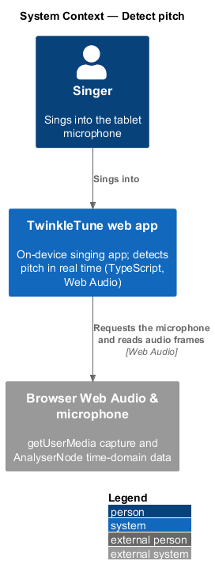
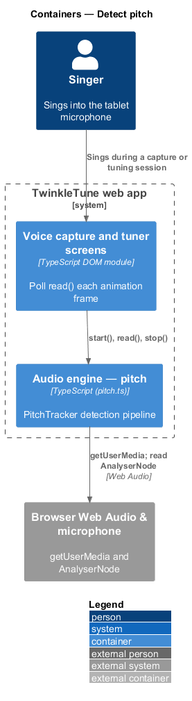
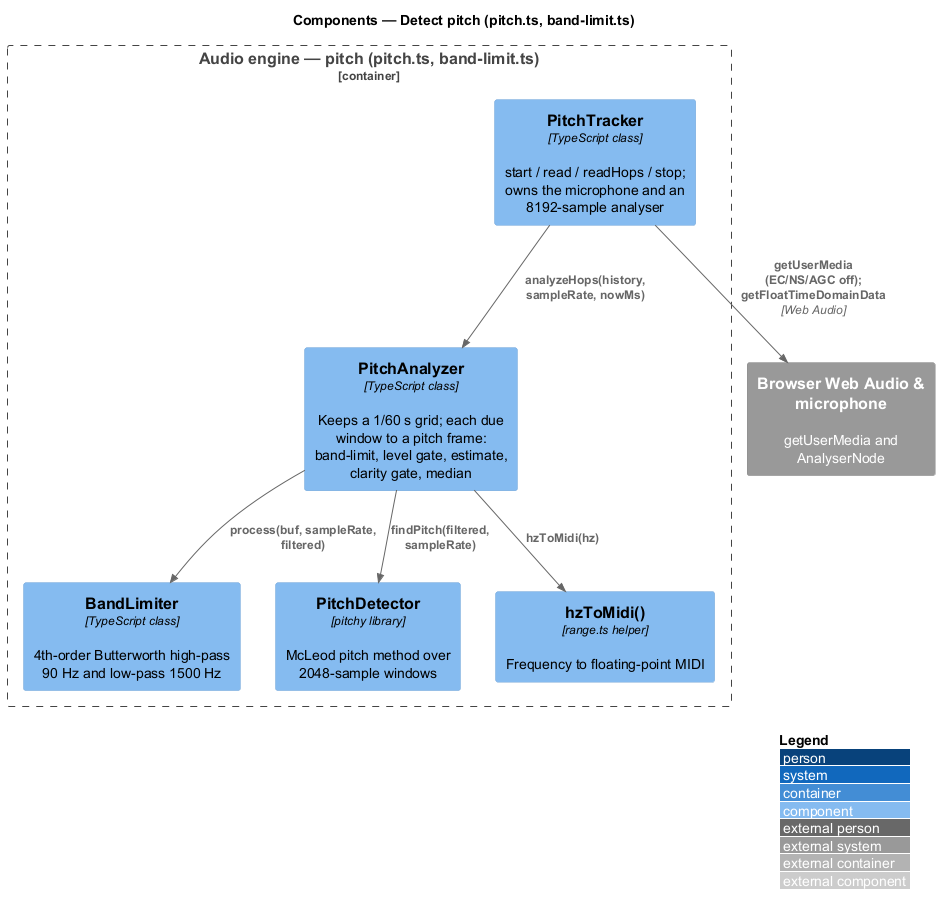
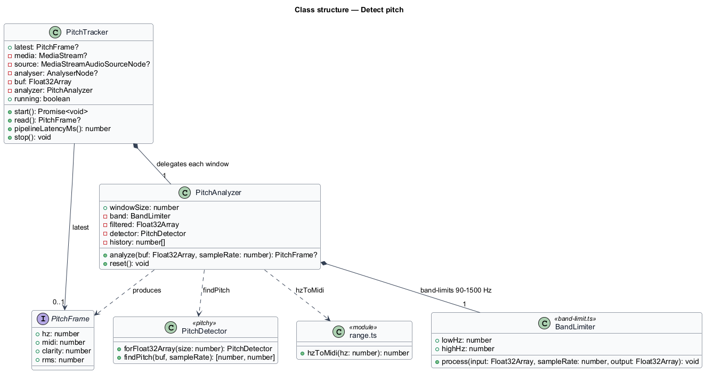
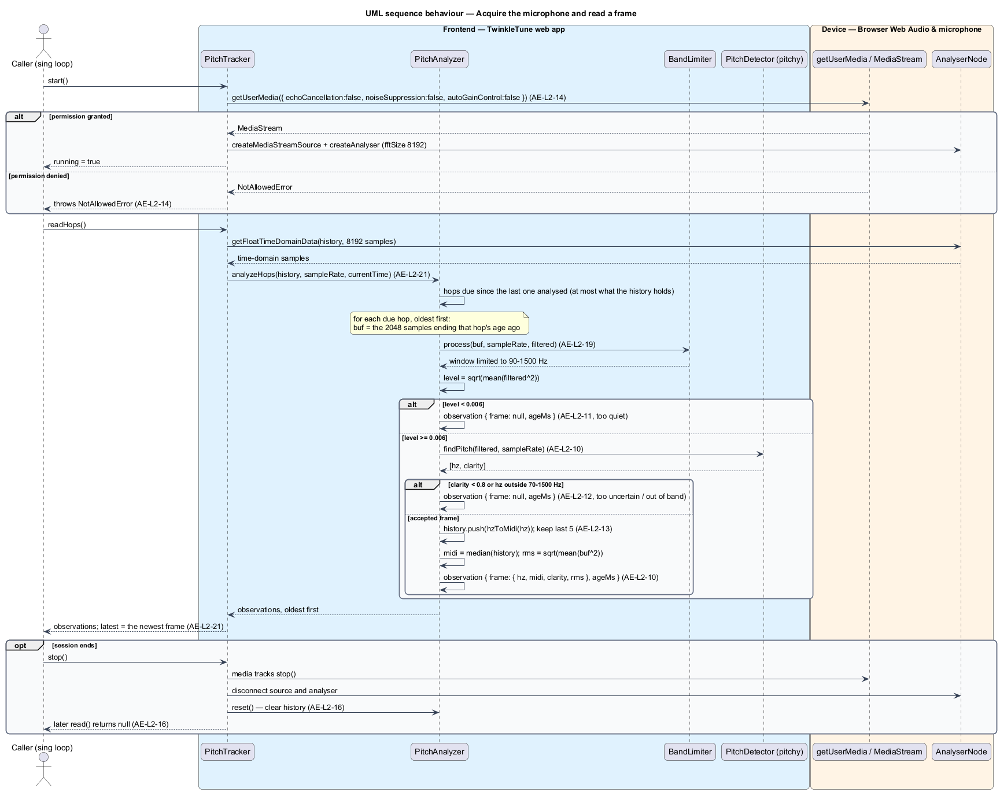

# Detect pitch

## Overview

TwinkleTune listens to a child sing and reports the pitch in real time, so
gameplay and scoring can react to whether the note is high or low. Detection runs
on the device from the microphone; no audio leaves the tablet. Homes are noisy
and tablets are budget hardware, so the detector first narrows what it listens to
down to the band a singing voice lives in, then rejects sound that is too quiet
or too uncertain to be a sung note, and smooths brief octave jumps.

audio engine — on-device layer that synthesises a song's melody and detects the
singer's pitch

This feature covers pitch input: acquiring the microphone, analysing a window of
samples on a fixed step of audio time, band-limiting, gating and smoothing the
result, and releasing the microphone on stop. It reports raw pitch only; deciding whether the
pitch is correct belongs to scoring, and finding a comfortable vocal range
belongs to voice personalization. It runs offline on the device.

The terms below are used throughout.

- pitch frame — result of analysing one window, carrying `hz`, a floating-point
  `midi`, a `clarity`, and an `rms`, or absent when the window is rejected
- hop — fixed step of audio time, 1/60 s, between one analysed window and the
  next
- observation — pitch frame (or none) for one hop, with the age of the end of
  its window at the moment of the poll
- history — most recent 8192 samples held by the analyser, enough for a window
  ending up to 128 ms ago at 48 kHz
- McLeod pitch method — autocorrelation-based algorithm, supplied by the `pitchy`
  library, that estimates a fundamental frequency and a clarity from a window of
  samples
- singing band — 90 Hz to 1500 Hz, the range holding sung fundamentals and their
  first harmonics
- band limiting — filtering of a window down to the singing band before anything
  else looks at it
- Butterworth filter — filter with a maximally flat passband; a 4th-order one
  falls away at 24 dB per octave beyond its cutoff
- biquad — second-order filter section; two in cascade make a 4th-order filter
- RMS — root-mean-square amplitude of a window
- band-limited level — RMS of the band-limited window, used as the loudness gate
- clarity — detector confidence in the range 0 to 1, used to reject uncertain
  detections
- median filter — smoothing that reports the median of the most recent accepted
  MIDI values, so one octave-error blip cannot swing the result
- floating-point MIDI — MIDI note number carried as a real number, so a pitch
  between two semitones is representable

## Description

The feature is a frontend-only slice inside `frontend/src/audio/pitch.ts` and
`frontend/src/audio/band-limit.ts`, with one helper from `range.ts` and the
`pitchy` library. No server participates. The signal processing is separated
from the Web Audio plumbing so it can be driven by synthesised audio in tests.

- **`PitchTracker`** — class that owns the microphone and analysis graph.
  `start()` acquires the stream and builds the analyser; `read()` and
  `readHops()` copy the history out of the analyser and hand it to its
  `PitchAnalyzer`; `stop()` releases everything. The `running` getter is true
  while an analyser exists.
- **`start()`** — async method that calls `getUserMedia` with `echoCancellation`,
  `noiseSuppression`, and `autoGainControl` all `false`, on the system default
  or, when the device has a microphone choice, on that microphone with a
  fallback to the system default if it is unavailable (`AE-L2-22`; see
  [choose microphone](../../grown-ups-corner/choose-microphone/README.md)). A
  permission denial is rethrown whichever was asked for. It then builds a
  `MediaStreamAudioSourceNode` and an `AnalyserNode` with
  `fftSize = HISTORY_SIZE`, and connects them.
- **`read()`** — analyses the newest window only and returns its frame. The
  tuner and Find My Voice, which want the pitch right now, use it.
- **`readHops()`** — returns every observation that has come due since the
  previous call, by passing the history and the audio clock
  (`AudioContext.currentTime`) to `PitchAnalyzer.analyzeHops`; `latest` becomes
  the newest observation's frame. The sing loop uses it, so judging sees the
  voice sixty times a second however the display is pacing. A caller uses one
  of `read()` and `readHops()`, not both, since each advances the smoothing
  history. A denied permission surfaces as a `NotAllowedError` thrown to
  the caller.
- **`stop()`** — method that stops the media tracks, disconnects the source and
  analyser, nulls the graph, and clears the analyzer's history and `latest`.
- **`PitchAnalyzer`** — pure class turning one window into a `PitchFrame` or
  `null`. `analyze(buf, sampleRate)` runs these steps in order:
  1. band-limit `buf` into a scratch window with `BandLimiter.process`;
  2. compute the band-limited level and return `null` when it is below
     `MIN_BAND_RMS`;
  3. call `detector.findPitch(filtered, sampleRate)` and return `null` when
     `clarity < MIN_CLARITY`, `hz < MIN_HZ`, or `hz > MAX_HZ`;
  4. push `hzToMidi(hz)` into `history`, keep the last `MEDIAN_WINDOW` values,
     and report the median as `midi`, with `rms` computed from the unfiltered
     `buf` so level displays keep their meaning.
- **`PitchAnalyzer.analyzeHops(history, sampleRate, nowMs)`** — keeps a grid of
  hop times on the audio clock. It counts the hops that have come due since the
  last one it analysed, caps the count at what the history holds beyond one
  window, and for each, oldest first, analyses the `windowSize` samples ending
  that hop's age before the end of `history` and emits
  `{ frame, ageMs }`. The grid then advances by exactly the hops emitted, so the
  remainder of a hop carries to the next call and the analysed windows stay
  evenly spaced in audio time whatever the spacing of the calls. After a stall
  longer than the history the grid restarts at the oldest window that fits.
- **`BandLimiter(lowHz, highHz)`** — class in `band-limit.ts` holding a 4th-order
  Butterworth high-pass at `lowHz` and a 4th-order Butterworth low-pass at
  `highHz`, each as two cascaded biquads with section Qs 0.5412 and 1.3066.
  `process(input, sampleRate, output)` derives the coefficients for the sample
  rate (cached until the rate changes) and filters the window from rest. Starting
  from rest costs a few milliseconds of settling at the head of a 43 ms window,
  which the detector tolerates; it keeps windows independent, so overlapping
  frames never share state.
- **`PitchFrame`** — result type with `hz`, `midi` (float, `60.0 = C4`),
  `clarity` (0 to 1), and `rms` (unfiltered level).
- **`PitchDetector.forFloat32Array(FFT_SIZE)`** — `pitchy` detector configured
  for the 2048-sample window; `findPitch` returns `[hz, clarity]`.
- **`hzToMidi(hz)`** — `range.ts` helper computing `69 + 12·log2(hz/440)`.

Constants (the shipped baseline): `FFT_SIZE = 2048`, `HISTORY_SIZE = 8192`,
`HOP_MS = 1000 / 60`, `BAND_LOW_HZ = 90`,
`BAND_HIGH_HZ = 1500`, `MIN_BAND_RMS = 0.006`, `MIN_CLARITY = 0.8`,
`MIN_HZ = 70`, `MAX_HZ = 1500`, `MEDIAN_WINDOW = 5`.

### Why band-limit

The McLeod method scores how periodic a window is, and broadband sound — breath,
hiss, a fan — is not periodic. Once that sound approaches the level of the voice
the clarity drops under the threshold and every frame is rejected: the detector
does not degrade, it goes deaf. Hum and rumble below the voice do the same from
the other side. Almost all of that energy lies outside 90–1500 Hz, while a sung
fundamental and the harmonics that carry its periodicity lie inside, so removing
the rest restores the detector's confidence without touching what it measures.

The high-pass sits at 90 Hz although pitches down to 70 Hz are accepted: a voice
that low is still tracked through its harmonics, and the higher cutoff takes
10 dB more off 60 Hz mains hum. The level gate moves inside the band and down to
0.006, because a voice loses little to the filter while white noise loses about
12 dB; the gate is therefore both more sensitive to a quiet voice and harder for
noise to open.

Driving the reference singer of the scoring subsystem through the pipeline over
all bundled songs (210 notes):

| Condition | Unfiltered detector | Band-limited |
|-----------|---------------------|--------------|
| Reference room | 99.5% landed | 99.5% |
| Breath noise louder than the voice's fundamental | 0% | 100% |
| Broadband hiss as loud as the voice | 0% | 99.5% |
| 60 Hz hum louder than the voice | 0% | 99.5% |
| Very quiet voice | 91% | 98.6% |
| Nobody singing, same hiss or hum | no pitch frames | no pitch frames |

The filter starts each window from rest, so its settling shows in whole-window
figures: a 6 kHz tone is down 40 dB over the whole window and 50 dB over its
second half; 60 Hz hum is down 14 dB either way.

### Why a fixed step

Polling once per animation frame ties how often the voice is sampled to how fast
the device can draw. A tablet drawing 20 frames a second looked at the voice
three times less often than one drawing 60, and a stutter left a hole in what
was heard, so short notes went uncredited for reasons that had nothing to do
with the singing. The audio itself is never lost — the analyser holds the last
8192 samples — so each poll can catch up on the hops it missed. Driving the
reference singer through the pipeline over all bundled songs:

| Sing loop | One window per frame | Fixed 1/60 s step |
|-----------|----------------------|-------------------|
| 60 frames a second | 99.5% landed (short notes 97%) | 99.5% (short notes 97%) |
| 30 frames a second | 99.5% (short notes 97%) | 99.5% (short notes 97%) |
| 20 frames a second | 95.2% (short notes 71%) | 99.5% (short notes 97%) |
| 15 frames a second | 93.3% (short notes 59%) | 99.5% (short notes 97%) |
| 60 a second, one frame in five late | 97.1% (short notes 82%) | 99.5% (short notes 97%) |

## Requirements

The feature realizes the following level-2 (L2) requirements. Each L2 requirement
refines a level-1 (L1) requirement, cited by identifier.

| L2 ID | Refines (L1) | Requirement |
|-------|--------------|-------------|
| `AE-L2-10` | `AE-L1-4` | The engine shall analyse 2048-sample time-domain windows, band-limited per `AE-L2-19`, with the McLeod pitch method and, for an accepted frame, report `{ hz, midi, clarity, rms }` where `midi` is a float (`69 + 12·log2(hz/440)`) and `rms` is the level of the unfiltered window. |
| `AE-L2-11` | `AE-L1-5` | The engine shall reject (report no pitch for) any frame whose band-limited RMS level is below 0.006, so quiet background noise does not register as singing. |
| `AE-L2-12` | `AE-L1-5` | The engine shall reject a frame whose detector clarity is below 0.8 or whose frequency falls outside 70–1500 Hz, so uncertain or out-of-band detections are discarded. |
| `AE-L2-13` | `AE-L1-4, AE-L1-5` | The reported MIDI value shall be the median of the most recent 5 accepted frames, so a single octave-error blip cannot swing the reported pitch. |
| `AE-L2-14` | `AE-L1-6` | The engine shall request the microphone with echo cancellation, noise suppression, and auto-gain **disabled** (to preserve pitch fidelity), and shall propagate a permission-denied error to the caller rather than swallowing it. |
| `AE-L2-16` | `AE-L1-6` | Stopping the tracker shall stop the media tracks, disconnect the audio nodes, and clear the smoothing history and last frame, so no microphone remains active and no stale pitch survives into a later session. |
| `AE-L2-19` | `AE-L1-5` | Before the level gate and the pitch estimate, each analysis window shall be band-limited to 90–1500 Hz by a 4th-order Butterworth high-pass at 90 Hz followed by a 4th-order Butterworth low-pass at 1500 Hz, computed for the context's sample rate. |
| `AE-L2-21` | `AE-L1-4` | The engine shall analyse the microphone signal on a fixed grid of audio time, one 2048-sample window every 1/60 s, however it is polled; each poll shall return, oldest first, one observation (a pitch frame or none, with the age of its window) for every hop that has come due since the previous poll, drawing on 8192 samples of history. |
| `AE-L2-20` | `AE-L1-4, AE-L1-5` | Taken end to end, the engine shall keep hearing an in-tune child through a breathy voice, broadband hiss, mains hum, or a quiet voice — at least 90% of notes landed in each case — and shall report no pitch at all when the same interference is present and nobody sings. |

## Diagrams

### System context

The singer sings into the TwinkleTune web app, which requests the microphone and
reads audio frames through the browser Web Audio API on the device.

### Containers

A voice-capture or tuner screen polls the pitch engine each frame, and the engine
acquires the microphone and reads the analyser through the browser.

### Components

Inside the pitch engine, `PitchTracker` reads the `AnalyserNode` and delegates
each window to `PitchAnalyzer`, which band-limits it with `BandLimiter`, takes
the frequency estimate from the `pitchy` `PitchDetector`, and converts frequency
to MIDI through `hzToMidi()`.

### Class structure

`PitchTracker` owns a `PitchAnalyzer` and exposes the latest `PitchFrame`; the
analyzer owns a `BandLimiter` and depends on the `pitchy` `PitchDetector` for
`findPitch` and on `range.ts` for `hzToMidi`.

### Behaviour — acquire the microphone and read a frame

`start()` requests the microphone — the chosen one when the device has a
microphone choice, the system default otherwise or as the fallback
(`AE-L2-22`) — with echo cancellation, noise suppression, and auto-gain off
(`AE-L2-14`); the `alt` models the denied-permission path.
`readHops()` then takes the history and, for each hop that has come due
(`AE-L2-21`), band-limits the window (`AE-L2-19`) and applies the level gate
(`AE-L2-11`), the McLeod estimate (`AE-L2-10`), the clarity and bounds gate
(`AE-L2-12`), and the median filter (`AE-L2-13`), with the too-quiet and
too-uncertain rejections shown as `alt` branches and the teardown (`AE-L2-16`) as
an `opt`.

