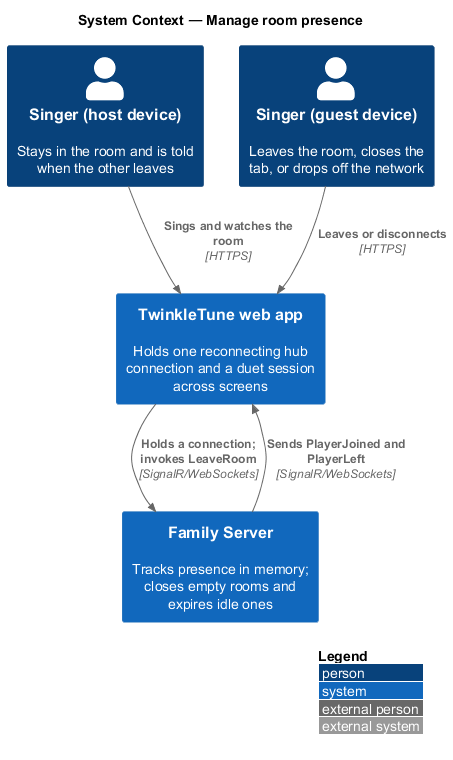
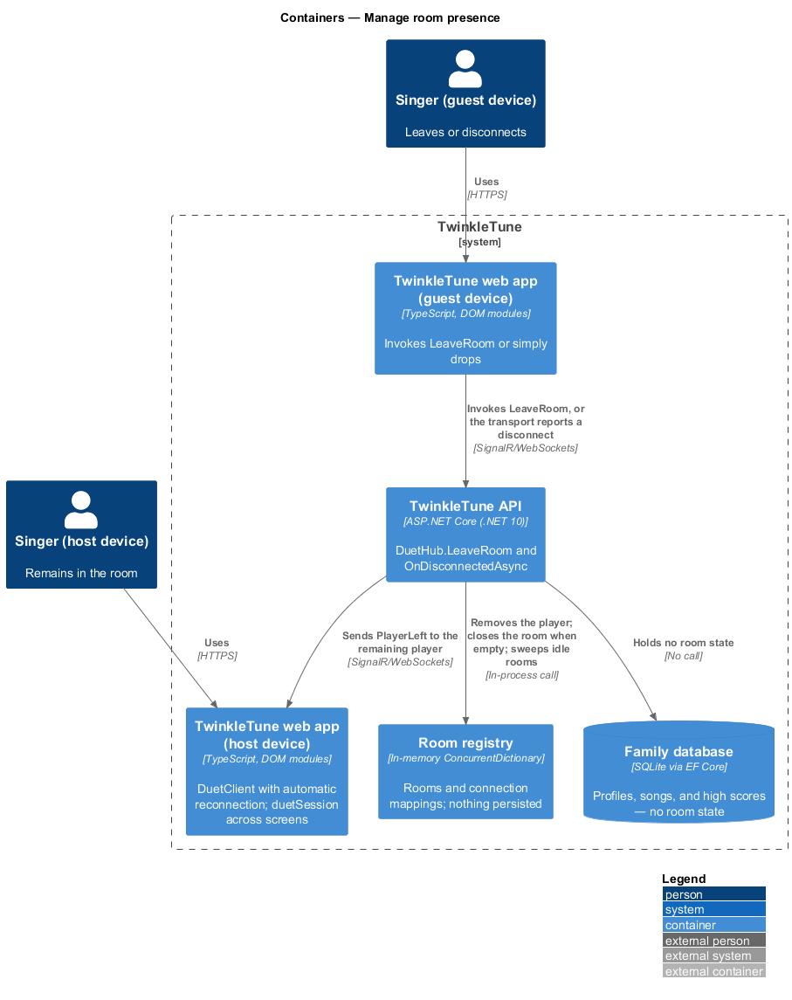
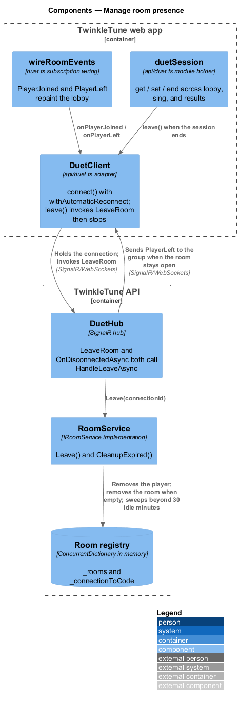
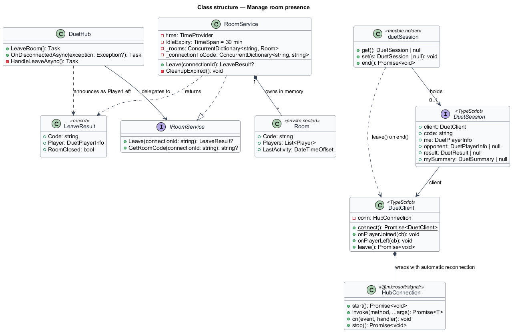
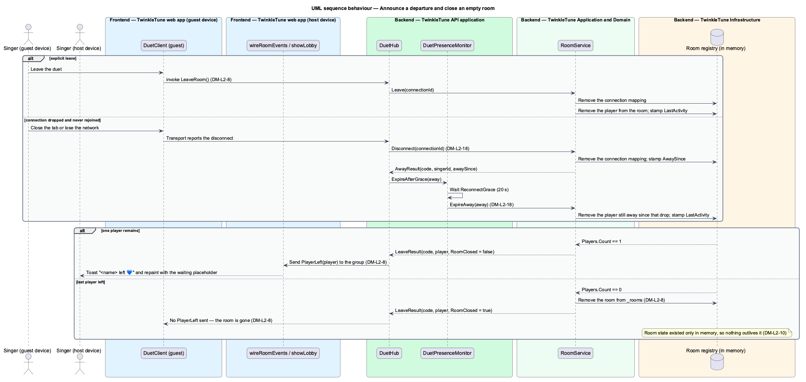
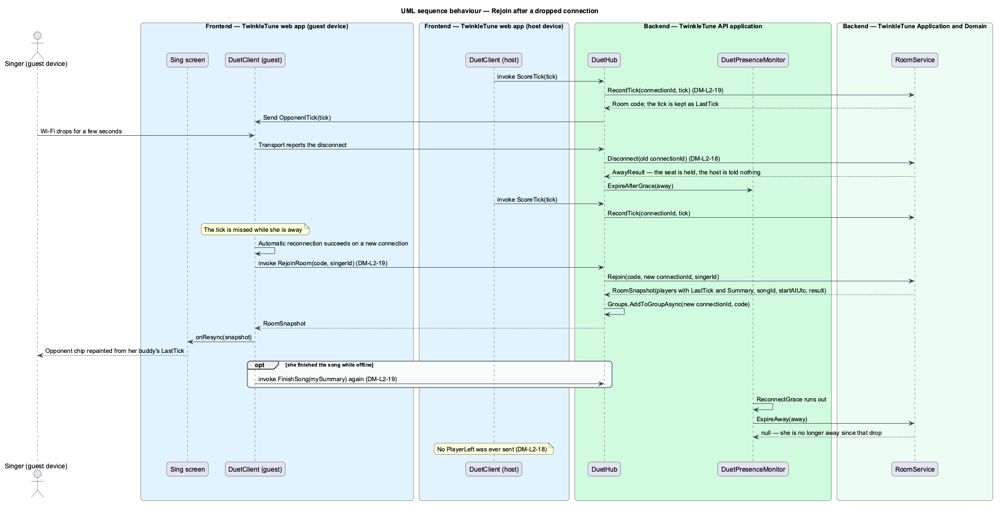
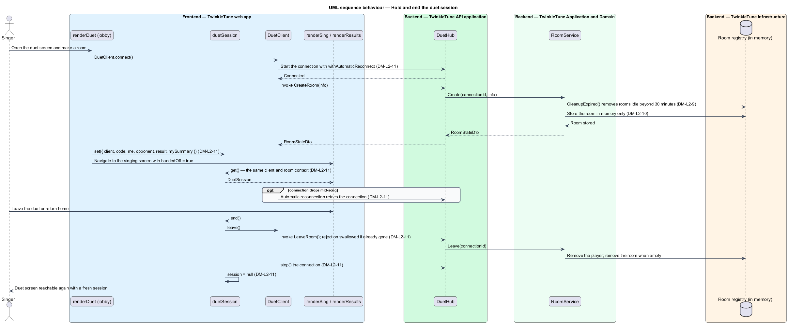

# Manage Room Presence

## Overview

Tablets get closed mid-song, Wi-Fi drops, and a duet buddy wanders off. This
feature is what keeps a room honest about who is actually in it: the arrival and
departure announcements, the grace that lets a dropped connection come back to
its seat, the closure of a room that no one is left in, and the sweep that
removes rooms nobody ever came back to. It also owns the connection itself — the
single wrapper the screens share, the reconnection policy, and the session object
that survives the walk from lobby to singing screen to results.

The terms below are used throughout.

- presence — record of which singers currently hold a connection to a room
- explicit leave — departure a singer chooses, invoking `LeaveRoom` before the
  connection stops
- disconnect — departure the transport reports, whether from a closed tab, a
  dropped network, or a stopped connection
- room closure — removal of a room from the registry once its last player is gone
- idle expiry — removal of a room whose last activity is older than 30 minutes
- reconnect grace — 20 seconds during which a dropped connection's seat is held
  and the other singer is told nothing
- away — state of a singer whose connection dropped and whose grace has not run
  out
- rejoin — binding of a held seat to a new connection, by room code and singer id
- room snapshot — the room as it stands, returned by a rejoin: both singers, the
  song and start time, each singer's latest tick and summary, and the combined
  result once both have finished
- automatic reconnection — SignalR client policy that retries a dropped
  connection without the screens taking part
- duet session — module-level holder carrying the live client, the room code, the
  local player, the opponent, the local summary, and the combined result across
  screen navigations

Presence underpins every other duet behaviour: the two-player cap, the start
precondition, and the both-finished test all read the player list this feature
maintains.

## Description

Frontend — duet API adapter (`frontend/src/api/duet.ts`):

- **`DuetClient.connect()`** — static factory building a `HubConnection` against
  `` `${API_URL}/hubs/duet` `` with `.withAutomaticReconnect()` and
  `.configureLogging(LogLevel.Warning)`, starting it, and wrapping it in a
  `DuetClient`. The constructor is private, so the connection is never handed to
  a screen directly.
- **`DuetClient.over(conn)`** — wraps a connection that is already started. It
  takes the `DuetConnection` interface — the `invoke`, `on`, `onreconnected`, and
  `stop` the client uses — so a test can stand in for the hub.
- **`createRoom(info)`** and **`joinRoom(code, info)`** — remember the seat
  (`code` and `singerId`) once the hub accepts, so a reconnect knows where to go
  back to.
- **`rejoin()`** — registered with `conn.onreconnected`. An automatic reconnect
  comes back on a new connection the room has never seen, so the client invokes
  `RejoinRoom(code, singerId)`, re-sends the finish summary of the song in
  progress when the snapshot shows the server never received it, and passes the
  `RoomSnapshot` to the screen's resync handler. A rejected rejoin is swallowed:
  the room closed while she was away and her own song carries on.
- **`onResync(cb)`** — sets the single handler called with the room as it stands
  after a reconnect. Each screen replaces the previous screen's handler.
- **`buddyIn(room, me)`** — the other singer's `PlayerSnapshot`, or `null` while
  she is alone.
- **`DuetClient.leave()`** — forgets the seat, invokes `LeaveRoom`, swallows a rejection from a
  connection that has already gone, and then calls `conn.stop()`.
- **`onPlayerJoined(cb)`** and **`onPlayerLeft(cb)`** — register handlers for the
  two presence events, each carrying a `DuetPlayerInfo`.
- **`DuetSession`** — interface with `client`, `code`, `me`, `opponent`,
  `result`, and `mySummary`.
- **`duetSession`** — module-level holder exposing `get()`, `set(s)`, and
  `end()`; `end()` calls `session.client.leave()` and then clears the session to
  `null`.

Frontend — screens (`frontend/src/screens/duet.ts`, `sing.ts`, `results.ts`):

- **`ensureClient()`** — returns the existing `client` or connects once, so the
  duet screen holds at most one connection.
- **`wireRoomEvents(c)`** — on `PlayerJoined` appends the player to
  `lobbyRoom.players` when not already present, raises the gold toast
  `` `${p.name} is here! 🎉` ``, and repaints; on `PlayerLeft` filters the player
  out, raises the pink toast `` `${p.name} left 💙` ``, and repaints.
- **lobby resync** — `wireRoomEvents` also sets `c.onResync`: the lobby repaints
  from the snapshot, and follows her buddy into the song when it started while
  she was away.
- **sing and results resync** — `renderSing` repaints the opponent chip from her
  buddy's `lastTick` and stores a combined result that arrived while she was
  away; the waiting results panel paints that result.
- **`renderDuet` teardown** — returns a function that calls `duetSession.end()`
  unless `handedOff` is true, so leaving the lobby releases the room while
  navigating into the song does not.
- **`renderSing`** — reads the session with `duetSession.get()` and redirects to
  `#/duet` when it is missing; leaving the duet from the pause menu calls
  `duetSession.end()` before navigating.
- **`results.ts`** — `Another duet 🎤🎤` awaits `duetSession.end()` before
  routing back to `#/duet`, and the home action ends the session as well.

Backend — TwinkleTune API application (`backend/src/TwinkleTune.Api/Hubs/DuetHub.cs`):

- **`LeaveRoom()`** — delegates to `HandleLeaveAsync()`.
- **`OnDisconnectedAsync(exception)`** — calls `rooms.Disconnect`, hands a
  non-null `AwayResult` to `DuetPresenceMonitor.ExpireAfterGrace`, and then calls
  the base implementation. A dropped connection is therefore not a leave: the
  seat is held and nobody is told.
- **`RejoinRoom(code, singerId)`** — calls `rooms.Rejoin`, throws a
  `HubException` carrying the friendly error when there is one, adds the new
  connection to the hub group, and returns the `RoomSnapshot`.
- **`ScoreTick(tick)`** — calls `rooms.RecordTick`, which remembers the tick for
  a later snapshot and returns the room code the relay needs.
- **`DuetPresenceMonitor`** (`Hubs/DuetPresenceMonitor.cs`) — singleton that
  outlives the hub call. `ExpireAfterGrace(away)` waits
  `rooms.ReconnectGrace` on the injected `TimeProvider`, calls
  `rooms.ExpireAway(away)`, and sends `PlayerLeft` through
  `IHubContext<DuetHub>` when a singer was removed and the room is still open.
  The wait is cancelled when the host stops.
- **`HandleLeaveAsync()`** — calls `rooms.Leave`, returns when the result is
  `null`, removes the connection from the hub group, and sends `PlayerLeft` with
  the departing player's info to `Clients.Group(left.Code)` only when
  `!left.RoomClosed`.
- **`JoinRoom`** — sends `PlayerJoined` with the joining player's info to
  `Clients.OthersInGroup(state.Code)`.

Backend — Application and Domain
(`backend/src/TwinkleTune.Application/Duet/RoomService.cs`):

- **`RoomService.Leave(connectionId)`** — removes the connection mapping with
  `_connectionToCode.TryRemove`, resolves the room, removes the player under
  `lock (room)`, stamps `room.LastActivity`, and removes the room from `_rooms`
  when the player list is empty. It returns a `LeaveResult` carrying the code,
  the departing player's info, and the `RoomClosed` flag.
- **`RoomService.Disconnect(connectionId)`** — removes the connection mapping,
  stamps the player's `AwaySince`, and returns an `AwayResult` with the code, the
  singer id, and that instant. The player stays in `room.Players`, so the
  two-player cap and the start precondition still count her.
- **`RoomService.ExpireAway(away)`** — removes the player only when a player with
  that singer id is still away since that same instant, so a grace that belongs
  to an earlier drop cannot remove a singer who came back. It returns the same
  `LeaveResult` an explicit leave does.
- **`RoomService.Rejoin(code, connectionId, singerId)`** — finds the singer's
  seat (preferring an away one, because the server may not have noticed the old
  connection die yet), rebinds it to the new connection, clears `AwaySince`, and
  returns a `RoomSnapshot`. A room that is gone, or that does not hold her,
  yields `"That room has closed — make a new one!"`.
- **`RoomService.Join`** — a singer whose seat is away and who joins with the
  code again takes that seat back instead of being refused as a third singer.
- **`RoomService.RecordTick(connectionId, tick)`** — stores the tick on the
  player as `LastTick`. `StartSong` clears every `LastTick` together with the
  summaries.
- **`RoomService.ReconnectGrace`** — `DefaultReconnectGrace` (20 seconds) unless
  `Duet:ReconnectGraceSeconds` is configured; `Program.cs` reads the setting and
  passes it through `AddApplicationServices`.
- **`RoomSnapshot`**, **`PlayerSnapshot`**, **`DuetResult`** — records carrying
  the room code, each singer's `Info`, `LastTick`, and `Summary`, the song id and
  start time, and the combined result (`DuetResult.From` sums the sparkles).
- **`CleanupExpired()`** — computes `cutoff = time.GetUtcNow() - IdleExpiry` and
  removes every room whose `LastActivity` is older, clearing the connection
  mapping of each of its players. It runs at the head of `Create` and `Join`, so
  the sweep is driven by traffic rather than by a timer.
- **`_rooms`** and **`_connectionToCode`** — the two `ConcurrentDictionary`
  instances that constitute the entire store. Nothing is written to the database,
  so a server restart leaves no rooms behind.
- **`LeaveResult`** — record with `Code`, `Player`, and `RoomClosed`.
- **`TimeProvider time`** — injected clock that `CleanupExpired` and every
  activity stamp read.

Constants (the shipped baseline): `IdleExpiry = TimeSpan.FromMinutes(30)`,
`MaxPlayers = 2`, `DefaultReconnectGrace = TimeSpan.FromSeconds(20)`. The grace
covers the first three attempts of the SignalR client's automatic reconnection
(at 0, 2, and 10 seconds).

Coverage: `RoomServiceTests` exercises leave, room closure, and idle removal;
`RoomReconnectTests` exercises the held seat, rejoin, the snapshot, and grace
expiry; `DuetFlowTests` exercises the `PlayerLeft` notification over a live
connection; `DuetReconnectTests` drops a real connection, rejoins on a new one,
and waits out the grace; `duet.test.ts` drives `DuetClient` over a stand-in
connection through a reconnect.

## Requirements

The feature realizes the following level-2 (L2) requirements. Each L2 requirement
refines a level-1 (L1) requirement, cited by identifier.

| L2 ID | Refines (L1) | Requirement |
|-------|--------------|-------------|
| `DM-L2-8` | `DM-L1-8` | The system shall announce a player joining, shall announce a player leaving (at once on an explicit leave, after the reconnect grace on a disconnect), and shall close a room once it is empty. |
| `DM-L2-18` | `DM-L1-8` | A dropped connection's seat shall be held for a reconnect grace of 20 seconds by default; only a singer who has not rejoined by then shall be removed and announced as having left. |
| `DM-L2-19` | `DM-L1-8` | A singer shall be able to rejoin her room on a new connection by room code and singer id and shall receive the room as it stands; after an automatic reconnect the client shall rejoin by itself. |
| `DM-L2-9` | `DM-L1-8` | Rooms idle for longer than 30 minutes shall be removed, releasing their players' connection mappings. |
| `DM-L2-10` | `DM-L1-8` | Room state shall be held only in memory and shall not survive a server restart. |
| `DM-L2-11` | `DM-L1-7, DM-L1-8` | The client shall wrap the hub connection with automatic reconnection, shall expose typed create, join, start, tick, and finish calls together with event subscriptions, and shall maintain a duet session across the lobby, singing, and results screens, ending it by leaving the room and stopping the connection when the duet is done. |

## Diagrams

### System context

Two singers hold connections to the family server; the server is the only thing
that knows who is currently in a room, and it forgets everything when it restarts
(`DM-L2-8`, `DM-L2-10`).

### Containers

Each web app holds one reconnecting hub connection; the registry lives in the API
process memory, with no database behind it (`DM-L2-10`, `DM-L2-11`).

### Components

`DuetClient` and `duetSession` own the connection and the cross-screen state;
`DuetHub.HandleLeaveAsync` takes an explicit leave to `RoomService.Leave`,
`DuetPresenceMonitor` waits out the grace of a dropped connection, and
`CleanupExpired` sweeps idle rooms (`DM-L2-8`, `DM-L2-9`, `DM-L2-11`,
`DM-L2-18`).

### Class structure

`LeaveResult` reports whether a departure closed the room, and `DuetSession`
holds the client and room context that outlives each screen (`DM-L2-8`,
`DM-L2-11`).

### Behaviour — announce a departure and close an empty room

The `alt` shows an explicit leave removing the singer at once and a dropped
connection removing her only when the reconnect grace runs out; either way the
remaining singer is told, and a room left with no players is removed from the
in-memory registry (`DM-L2-8`, `DM-L2-10`, `DM-L2-18`).

### Behaviour — rejoin after a dropped connection

The guest's connection drops mid-song; her seat is held, the client reconnects
and rejoins by itself, and the snapshot puts her screen back in step without the
host ever being told she left (`DM-L2-18`, `DM-L2-19`).

### Behaviour — hold and end the duet session

One connection is built with automatic reconnection and carried through the
lobby, singing, and results screens by `duetSession`; ending the session leaves
the room and stops the connection (`DM-L2-11`), and the next create or join
sweeps rooms idle beyond 30 minutes (`DM-L2-9`).

