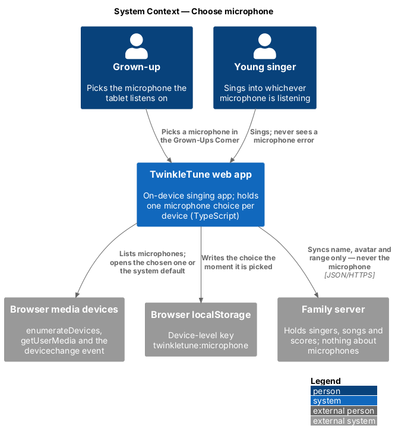
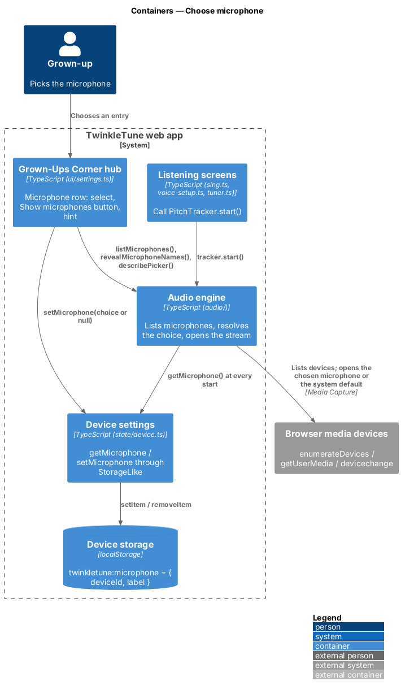
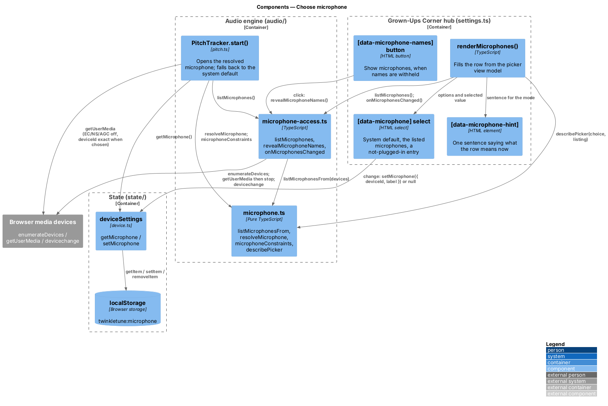
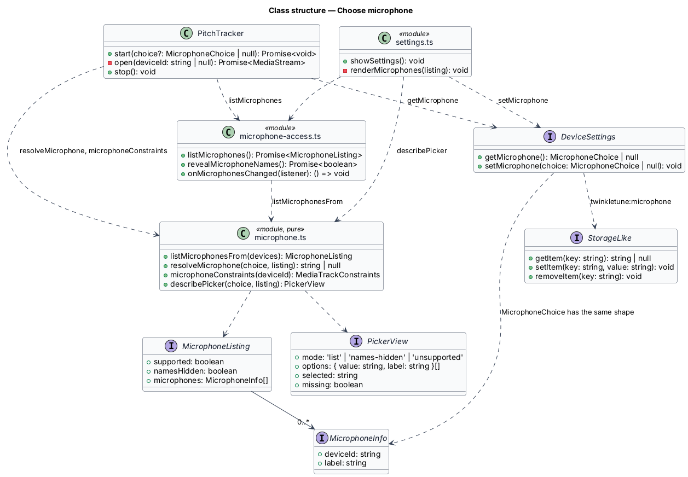
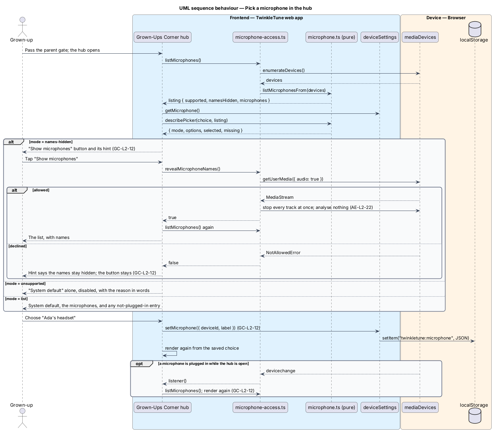
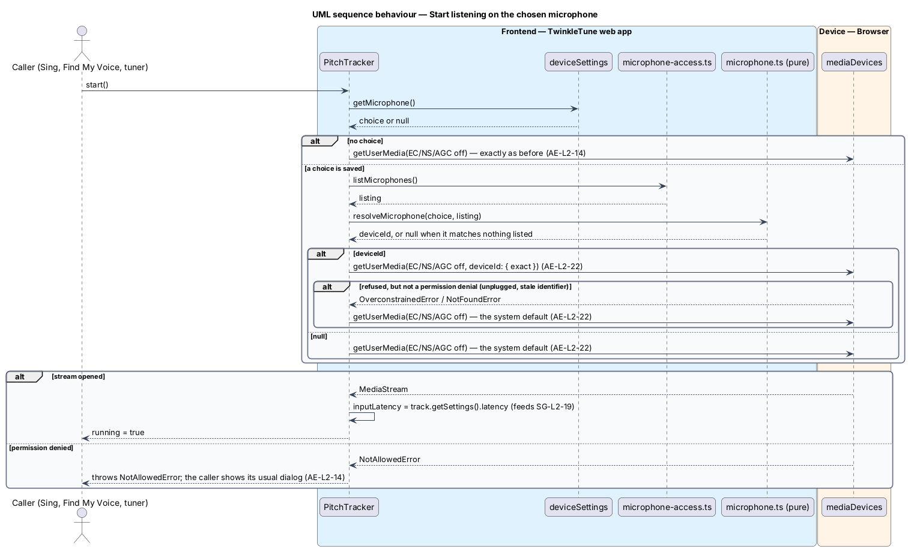

# Choose Microphone

## Overview

A tablet's own microphone hears two things at once: the singer and the melody
the tablet is playing. A headset microphone hears only the singer, which makes
pitch feedback steadier. Until now the app always listened on whatever the
browser handed over. The hub gives a grown-up one picker that names the
microphone to listen on, and the audio engine uses it everywhere the app
listens.

The choice belongs to the device, not to the person. Two singers on one tablet
share it, and one singer on two tablets has a different one on each. The design
keeps the value out of the singer's state blob and out of the server's singer
record for that reason. A missing microphone is never a failure: the app listens
on the system default and the child sees nothing.

The terms below are used throughout.

- microphone choice — the microphone a grown-up picked for this device, held as
  its identifier and its name
- system default — the microphone the browser hands over when a request names no
  device; what the app uses with no choice, or when the choice is unavailable
- microphone listing — what the browser reports about the device's microphones:
  whether it can list at all, whether names are withheld, and the microphones
- names withheld — state in which the browser lists microphones with empty
  names and identifiers because microphone permission has not been given yet
- microphone picker — the hub's "Microphone" row: a select, a "Show microphones"
  button, and a hint line
- device setting — value stored under a device-level storage key, outside every
  singer's blob

The feature covers the picker, where the choice is stored, and how the pitch
tracker asks the browser for it. The headphone tip a child sees before singing
is a separate feature in the singing gameplay subsystem.

## Description

The feature is a frontend-only slice. The deciding logic is pure and lives in
`frontend/src/audio/microphone.ts`; the browser calls live in
`frontend/src/audio/microphone-access.ts`; the choice is stored by
`frontend/src/state/device.ts`; the consumer is `PitchTracker.start()` in
`frontend/src/audio/pitch.ts`; the control lives in `frontend/src/ui/settings.ts`.

Pure logic (`audio/microphone.ts`, no DOM and no Web Audio):

- **`MicrophoneInfo`** — `{ deviceId: string, label: string }`. A
  `MicrophoneChoice` has the same shape: the identifier and name saved when the
  microphone was picked.
- **`MicrophoneListing`** — `{ supported: boolean, namesHidden: boolean,
  microphones: MicrophoneInfo[] }`.
- **`listMicrophonesFrom(devices)`** — turns the browser's device list into a
  listing. `null` (no `enumerateDevices`) gives `supported: false`. It keeps
  `audioinput` entries, drops the browser's own `default` and `communications`
  aliases, and reports `namesHidden` when there are microphones and none has a
  name; in that case `microphones` is empty, since an unnamed entry cannot be
  offered.
- **`resolveMicrophone(choice, listing)`** — returns the identifier to ask the
  browser for, or `null` for the system default. No choice gives `null`. A
  listed microphone with the saved identifier wins; failing that, a listed
  microphone with the saved name, by its current identifier. When the listing is
  unsupported or its names are withheld the function cannot know, and returns the
  saved identifier so the tracker can try it. Otherwise it returns `null`.
- **`microphoneConstraints(deviceId)`** — the audio constraints for
  `getUserMedia`: `echoCancellation`, `noiseSuppression` and `autoGainControl`
  all `false`, plus `deviceId: { exact: deviceId }` when an identifier is given.
  With `null` the object is exactly what the app has always sent.
- **`describePicker(choice, listing)`** — the picker's view model:
  `{ mode, options, selected, missing }`. `mode` is `'unsupported'`,
  `'names-hidden'` or `'list'`. `options` starts with `{ value: '', label:
  'System default' }` and continues with the listed microphones. `selected` is
  the resolved identifier or `''`. When a choice matches nothing in a listing
  with names, `missing` is `true` and one more option is appended and selected:
  the saved identifier, labelled `` `${choice.label} (not plugged in)` ``.

Browser access (`audio/microphone-access.ts`):

- **`listMicrophones()`** — awaits `navigator.mediaDevices.enumerateDevices()`
  and passes the result to `listMicrophonesFrom`; passes `null` when the method
  is absent or throws.
- **`revealMicrophoneNames()`** — calls `getUserMedia({ audio: true })`, stops
  every track of the returned stream at once, and resolves `true`; resolves
  `false` when the request is refused. No analyser is ever attached to that
  stream.
- **`onMicrophonesChanged(listener)`** — subscribes to the `devicechange` event
  on `navigator.mediaDevices` and returns an unsubscribe function.

Device setting (`state/device.ts`):

- **`MICROPHONE_KEY`** — `'twinkletune:microphone'`, a device-level key beside
  `twinkletune:active-singer`. It is not inside `twinkletune:v1[:singerId]`, so
  `store.switchKey()` and `store.reset()` do not touch it.
- **`createDeviceSettings(storage: StorageLike)`** — returns
  `getMicrophone(): MicrophoneChoice | null` and
  `setMicrophone(choice: MicrophoneChoice | null)`. The value is the JSON
  `{ deviceId, label }`; `null` removes the key. A value that does not parse, or
  lacks a string `deviceId`, reads as `null`.
- **`deviceSettings`** — the instance bound to the same `rootStorage` the store
  uses (`localStorage`, or an in-memory map where that is absent).

Tracker (`audio/pitch.ts`):

- **`PitchTracker.start(choice = deviceSettings.getMicrophone())`** — with no
  choice it opens the system default, exactly as before. With a choice it lists
  the microphones, resolves the choice, and opens the result. If opening a named
  microphone rejects with anything other than `NotAllowedError` or
  `SecurityError` (in practice `OverconstrainedError` or `NotFoundError`: the
  microphone is gone or its identifier is stale), it opens the system default
  instead. A permission denial is rethrown, so the Sing screen still shows
  "Can Twinkle hear you sing?" and Find My Voice its own dialog. All three
  callers (`sing.ts`, `voice-setup.ts`, `tuner.ts`) call `start()` with no
  argument, so none of them can forget the choice.
- **input latency** — `start()` already reads `latency` from the settings of the
  track it opened and feeds it to `pipelineLatencyMs()`. A wireless headset that
  reports its delay is therefore compensated by the existing estimate
  (`SG-L2-19`); this feature adds no compensation of its own.

Picker (`ui/settings.ts`):

- **markup** — one `.setting-row` after the mic timing offset: the label
  "Microphone" with a `<small data-microphone-hint>`, a
  `<select class="select select-sm" data-microphone aria-label="Microphone">`,
  and a `<button class="btn btn-sm btn-white" data-microphone-names>Show
  microphones</button>`. Only one of the select and the button is visible at a
  time.
- **`renderMicrophones(listing)`** — fills the row from `describePicker`. In
  `list` mode it shows the select with the options and the selected value; in
  `names-hidden` mode it hides the select and shows the button; in `unsupported`
  mode it shows the select disabled.
- **hint line** — one of five sentences, in words only: the headset advice
  (default), "Allow the microphone once to see the ones on this device"
  (names withheld), "The microphone was not allowed, so the names stay hidden.
  You can allow it in the browser's settings." (declined), "`<name>` is not
  plugged in, so the system default is listening for now" (missing), and "This
  browser picks the microphone itself" (unsupported).
- **select `change` handler** — `''` calls `deviceSettings.setMicrophone(null)`;
  any other value saves `{ deviceId, label }` of the chosen option. It then
  renders again, which removes a "not plugged in" entry that is no longer
  selected. There is no save button.
- **"Show microphones" handler** — awaits `revealMicrophoneNames()`, then lists
  and renders again; a refusal renders the declined hint and keeps the button.
- **refresh while open** — the hub subscribes with `onMicrophonesChanged` and
  lists and renders again on every change. The subscription is dropped by the
  first event that arrives after the hub has left the document.
- **reset** — the reset confirmation's `[data-yes]` calls
  `deviceSettings.setMicrophone(null)` beside `store.reset()`, and its body names
  the microphone choice among what is erased.

Constants (the shipped baseline): storage key `twinkletune:microphone`; option
label `System default`; suffix ` (not plugged in)`.

## Requirements

The feature realizes the following level-2 (L2) requirements. Each L2 requirement
refines a level-1 (L1) requirement, cited by identifier.

| L2 ID | Refines (L1) | Requirement |
|-------|--------------|-------------|
| `GC-L2-12` | `GC-L1-9` | The hub shall provide a microphone picker listing "System default" and each microphone the device reports; a pick saves at once; there is one choice per device, shared by every singer and never sent anywhere; it applies the next time the app starts listening; and the picker covers names not yet shared, permission declined, a remembered microphone that is not plugged in, a browser that cannot list microphones, and a microphone plugged in while the hub is open. |
| `AE-L2-22` | `AE-L1-8` | The engine shall list the device's microphones, start on the chosen one by identifier or failing that by name, and start on the system default when the choice matches nothing or the browser refuses it for any reason other than a permission denial. A stream opened only to learn the names is stopped at once and never analysed. |
| `AE-L2-14` | `AE-L1-6`, `AE-L1-8` | The engine shall request the microphone, chosen or default, with echo cancellation, noise suppression and auto-gain disabled, and shall propagate a permission-denied error to the caller. |
| `GC-L2-9` | `GC-L1-6` | The "start over" reset shall also forget the device's microphone choice. |
| `FS-L2-16` | `FS-L1-6` | The microphone choice is device-held; no request to the server carries it or any microphone name or identifier. |

## Diagrams

### System context

The grown-up picks a microphone on the tablet in front of them; the choice is
written to that device's own storage and nothing about it reaches the family
server (`GC-L2-12`, `FS-L2-16`).

### Containers

The hub writes the choice through the device settings; the audio engine reads it
whenever a screen starts listening (`GC-L2-12`, `AE-L2-22`).

### Components

The pure functions decide what to show and what to ask for; the access module
and the tracker are the only parts that talk to the browser (`AE-L2-22`,
`AE-L2-14`).

### Class structure

`MicrophoneChoice` is held by `DeviceSettings` behind `StorageLike`, outside
`AppState`; `PitchTracker` and the hub both reach it through the same instance
(`GC-L2-12`).

### Behaviour — pick a microphone in the hub

Opening the hub lists the microphones. With names withheld the row offers "Show
microphones", which opens the microphone only to stop it again. A pick is saved
by the `change` event itself (`GC-L2-12`, `AE-L2-22`).

### Behaviour — start listening on the chosen microphone

`start()` resolves the saved choice against what is plugged in. A microphone
that is missing or refused falls back to the system default; only a permission
denial reaches the caller (`AE-L2-22`, `AE-L2-14`).

## Open questions

Decisions taken, with their known consequences.

1. **Stored under a device-level key, not in the singer's blob.** The choice is
   `twinkletune:microphone`, beside `twinkletune:active-singer`. It does not
   change when the active singer changes and is never part of what
   `pushProfileToServer()` sends. `latencyMs` is also described as a device
   property yet is stored on each singer's `Profile`; moving it is out of scope
   here and remains open.
2. **Identifier and name are both stored.** A browser's device identifiers
   change when site data is cleared and, in some browsers, between visits; the
   name survives. Matching by identifier first and by name second means a
   rotated identifier still finds the headset. Consequence: two microphones with
   the same name cannot be told apart once the identifier has rotated; the first
   one listed is used.
3. **The stored identifier is not rewritten after a match by name.** The saved
   value changes only when a grown-up picks something. A rotated identifier is
   matched by name on every start.
4. **Names withheld at the start of a song.** When the browser has not shared
   names (no persistent permission), the tracker asks for the saved identifier
   without knowing whether it is valid. If the identifier has also rotated, the
   request is refused and the song starts on the system default for that
   session, even though the headset is plugged in. Re-listing after the fallback
   stream is open and reopening by name would fix this at the cost of a second
   microphone start; it is not done.
5. **A missing microphone keeps the choice.** The picker shows it as "not
   plugged in" and the app uses the system default. Plugging the headset back in
   needs no visit to the hub. Nothing tells the child or the grown-up outside
   the hub that the default is in use.
6. **The choice takes effect at the next start, not at once.** Screens that are
   listening when the hub is open (none can be: the hub opens from Welcome and
   Me) would keep their stream.
7. **Reset forgets the choice.** "Start everything over" hands the device on
   clean, so it clears the choice as it clears the mic timing offset. The
   confirmation says so.
8. **The list refreshes on `devicechange`.** Browsers that do not fire the event
   show the list as it was when the hub opened; closing and reopening refreshes
   it.
9. **No test step and no level meter in the picker.** A grown-up finds out
   whether the right microphone is listening by singing a song or opening the
   tuner. Deferred.
10. **The privacy disclosure is unchanged.** It lists what leaves the device;
    the microphone choice does not, so `GC-L2-10`'s copy still tells the truth.
