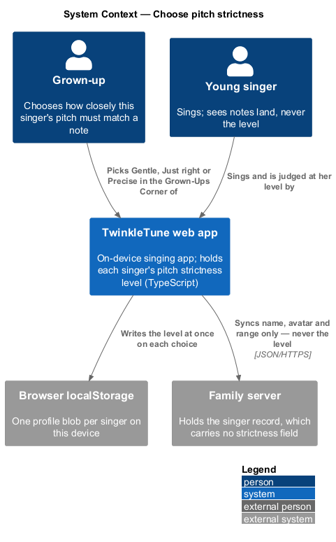
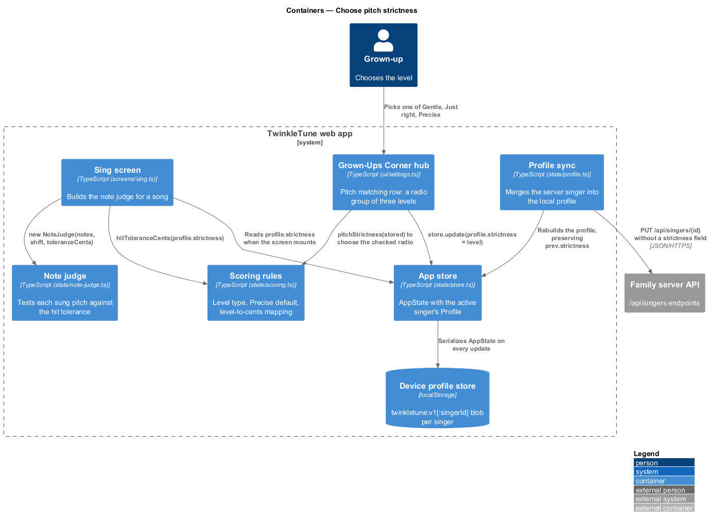
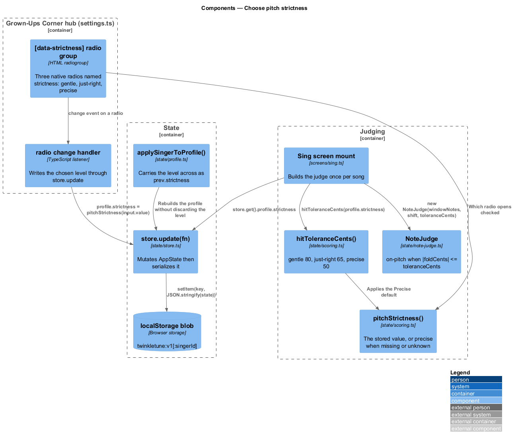
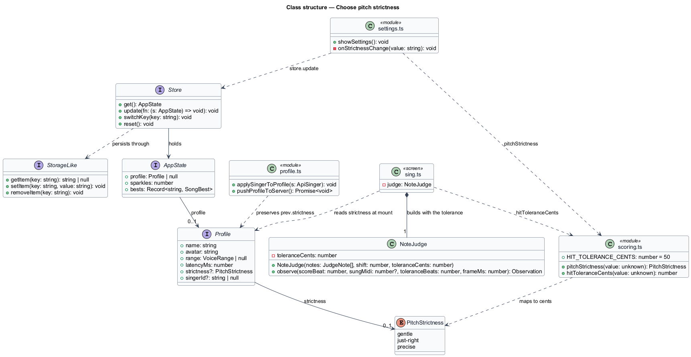
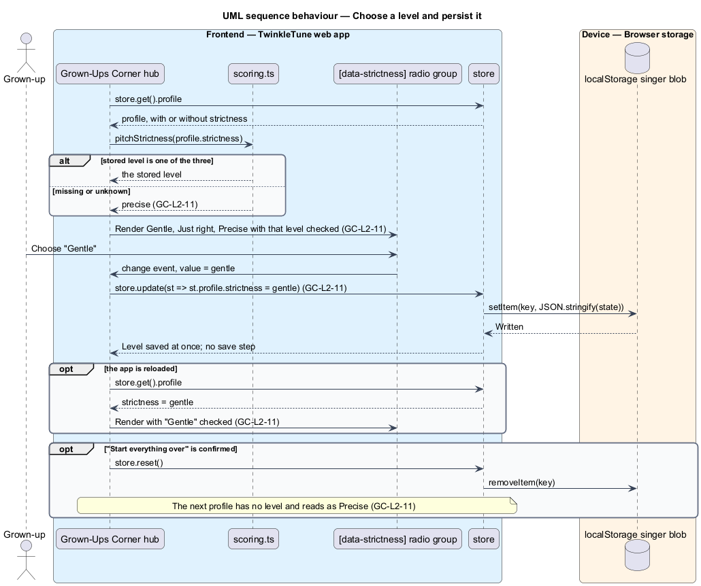
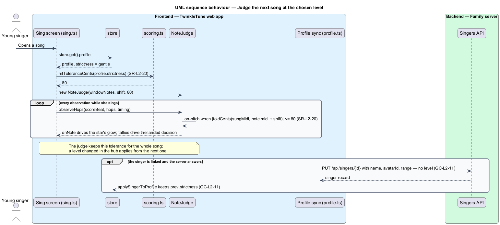

# Choose Pitch Strictness

## Overview

TwinkleTune counts a note as sung when the singer's pitch falls inside a band
around it. One fixed band does not suit every child: a five-year-old who sings a
little flat lands few notes at a width that a nine-year-old finds easy. The hub
gives a grown-up one choice, per singer, of how wide that band is. The child
never sees the choice or the level; she only sees notes landing.

The level belongs to the singer on the device in front of the grown-up. Two
singers on one tablet keep different levels, and the level is not part of the
singer record on the family server. How a child is judged is the family's
business, so the design keeps it off the network entirely.

The terms below are used throughout.

- pitch strictness — how closely a singer's pitch must match a note for it to
  count; one of three levels
- level — Gentle, Just right, or Precise, stored as `'gentle'`, `'just-right'`,
  or `'precise'`
- hit tolerance — half-width, in cents after octave folding, of the band inside
  which a sung pitch is on-pitch for a note: 80, 65, or 50 by level
- Precise default — treatment of a missing or unrecognised stored level as
  Precise, which is the rule every singer was judged by before the levels existed
- pitch matching row — the row of the hub that carries the choice, labelled
  "Pitch matching"
- device-held — stored in the singer's own blob in the device's `localStorage`
  and never sent to the family server

The feature covers the control, its persistence, the mapping from level to hit
tolerance, and the point at which the note judge is given that tolerance. What
the judge does with a tolerance belongs to the singing gameplay and scoring
subsystems.

## Description

The feature is a frontend-only slice. The control lives in
`frontend/src/ui/settings.ts`, the level lives on `Profile` in
`frontend/src/state/store.ts`, the mapping lives beside the other scoring rules
in `frontend/src/state/scoring.ts`, and the consumer is the note judge built by
`frontend/src/screens/sing.ts`. No server participates.

- **`PitchStrictness`** — type in `scoring.ts`: `'gentle' | 'just-right' |
  'precise'`. The stored shape is the level's name, not a cents number, so the
  mapping can change without rewriting anyone's stored choice.
- **`pitchStrictness(value)`** — pure function in `scoring.ts` returning `value`
  when it is one of the three names and `'precise'` otherwise. It is the single
  place the Precise default is decided, for a missing field, an old blob, and a
  value nobody recognises alike.
- **`hitToleranceCents(value)`** — pure function in `scoring.ts` returning `80`,
  `65`, or `50` for `pitchStrictness(value)`. `HIT_TOLERANCE_CENTS` stays as the
  Precise figure, `50`.
- **`Profile.strictness?: PitchStrictness`** — optional field on the profile
  interface in `store.ts`. A blob written before the field existed simply lacks
  it and reads as Precise.
- **pitch matching row markup** — a `.setting-row` holding the label span
  (`id="strictness-label"`, "Pitch matching" with the hint "How close a note must
  be to count") and a `div.radio-group[role="radiogroup"][data-strictness]`
  labelled by that span. It contains three `label.radio`, each a native
  `input[type="radio"][name="strictness"]` with the level's name as its `value`,
  a `.radio-dot`, and the visible label "Gentle", "Just right", or "Precise". The
  input whose value equals `pitchStrictness(profile?.strictness)` renders
  `checked`. Native radios give the accessible name, the keyboard behaviour, and
  a chosen state assistive technology reads; the filled dot marks the choice
  without relying on colour.
- **radio `change` handler** — bound in `onMount` on the radio group. It calls
  `store.update((st) => { if (st.profile) st.profile.strictness =
  pitchStrictness(input.value) })`. There is no save step: the choice is
  persisted by the same event that makes it.
- **`Store.update(fn)`** — mutates the in-memory `AppState` and writes it through
  the `StorageLike` seam, to `twinkletune:v1` or, once a singer is linked,
  `` `twinkletune:v1:${singerId}` ``. Each singer has her own blob, which is what
  makes the level per singer.
- **`applySingerToProfile(s)`** — the profile merge in
  `frontend/src/state/profile.ts`. It rebuilds the profile from the server's
  singer record and carries the level across as `prev?.strictness`, exactly as it
  carries `latencyMs`, so a server round trip cannot discard the device's choice.
- **welcome-screen profile creation** — `frontend/src/screens/welcome.ts`
  rebuilds the profile from the form and carries `prev?.strictness` across in the
  same way.
- **`pushProfileToServer()`** — the outbound sync in `profile.ts`. Its request
  body carries `name`, `avatarId`, `rangeLow`, and `rangeHigh` only. The level is
  absent, which is what keeps it device-held.
- **`store.reset()`** — "Start everything over" replaces the state with an empty
  one and removes the blob, so the next profile has no level and reads as
  Precise.
- **`NoteJudge(notes, shift, toleranceCents)`** — the judge's constructor takes
  the hit tolerance as a third argument that defaults to `HIT_TOLERANCE_CENTS`.
  A caller that passes nothing gets the judging it had before. The judge's one
  on-pitch test, `|foldCents(sungMidi, note.midi + shift)| <= toleranceCents`,
  serves both the active note and a neighbouring note.
- **judge construction in `sing.ts`** — `new NoteJudge(windowNotes, shift,
  hitToleranceCents(profile.strictness))`, once, when the Sing screen mounts.
  Solo play, practice, and duets all go through this one line. A level changed in
  the hub therefore applies from the next song, never part-way through one.

Constants (the shipped baseline): Gentle `80` cents, Just right `65` cents,
Precise `50` cents (`HIT_TOLERANCE_CENTS`), default level Precise.

### Decisions and known consequences

- **The level's name is stored, not its width.** A stored `65` would freeze
  today's mapping into every blob.
- **Per singer and device-held, unlike the two existing profile properties.** Mic
  latency is device-held because it describes the device; voice range syncs
  because it describes the person. The level describes the person but is a
  grown-up's private choice, so it is kept with the singer's blob on the device
  and left out of the sync. A singer who uses two devices has a level on each.
- **One tolerance drives everything the child sees.** The on-note glow and scene
  burst come from `Observation.onNote`, and the cheer, streak, and sparkles from
  `noteLanded` over tallies the same judge accumulated. Both therefore follow the
  singer's level, and the live feedback can never disagree with the result.
- **Overlapping bands.** Notes a semitone apart are 100 cents apart, so their
  bands overlap on Gentle (by 60 cents) and on Just right (by 30), and touch at
  exactly 50 cents on Precise. A pitch inside both is settled by the judge's
  existing order: the active note takes it, and a neighbour is considered only
  when the active note does not match.
- **Family high scores and duet scores compare singers who may be on different
  levels.** A Gentle singer and a Precise singer appear on the same board, and
  two duet partners may be judged by different bands. This is recorded and left
  as it is: the boards are a family's own, and labelling or weighting scores by
  level is deferred.
- **Existing scores are untouched.** No stored level means Precise, so a singer
  for whom no grown-up makes a choice is judged exactly as before.
- **A taller hub.** The row makes the hub taller than a small screen. The modal
  overlay scrolls a dialog taller than the screen (`AS-L2-6`), so "Close" stays
  reachable.

## Requirements

The feature realizes the following level-2 (L2) requirements. Each L2 requirement
refines a level-1 (L1) requirement, cited by identifier.

| L2 ID | Refines (L1) | Requirement |
|-------|--------------|-------------|
| `GC-L2-11` | `GC-L1-8` | The hub shall offer a one-of-three choice of pitch strictness for the active singer, labelled "Gentle", "Just right", and "Precise", with exactly one level chosen at a time. The control shall open on the singer's stored level, and on Precise when she has none or the stored value is not one of the three. Choosing a level shall save it at once, with no separate save step. The level shall belong to the active singer on this device and shall not be sent to the family server. "Start everything over" shall return it to Precise. |
| `SR-L2-20` | `SR-L1-1, SR-L1-2` | The hit tolerance shall follow the singer's pitch strictness level: ±80 cents on Gentle, ±65 on Just right, ±50 on Precise, with an inclusive bound. A singer with no level, or with a value that is not one of the three, shall be judged as Precise. The same tolerance shall drive the live on-note feedback and the landed decision. |

## Diagrams

### System context

The grown-up chooses a level for the singer in front of them; it is written to
that singer's own storage on the device and is not carried to the family server
(`GC-L2-11`).

### Containers

The hub writes the level into the singer's profile in the app store, the profile
sync preserves it without sending it, and the Sing screen reads it once to build
the note judge (`GC-L2-11`, `SR-L2-20`).

### Components

The radio group's `change` handler calls `store.update`; the Sing screen turns
the stored level into a hit tolerance through `hitToleranceCents` and hands it to
`NoteJudge` (`GC-L2-11`, `SR-L2-20`).

### Class structure

`strictness` is an optional field of `Profile`, written through `Store`;
`scoring.ts` owns the level type and the two pure functions that read it, and
`NoteJudge` holds the resulting tolerance (`GC-L2-11`, `SR-L2-20`).

### Behaviour — choose a level and persist it

The hub opens on the stored level, or on Precise when there is none, and each
`change` event writes the new level straight to the singer's persisted profile,
so no separate save step exists (`GC-L2-11`).

### Behaviour — judge the next song at the chosen level

The Sing screen maps the singer's level to a hit tolerance once, when it mounts,
and the judge uses that one tolerance for the on-note feedback and the landed
decision alike; a concurrent server sync keeps the device's level rather than
replacing it (`SR-L2-20`, `GC-L2-11`).

