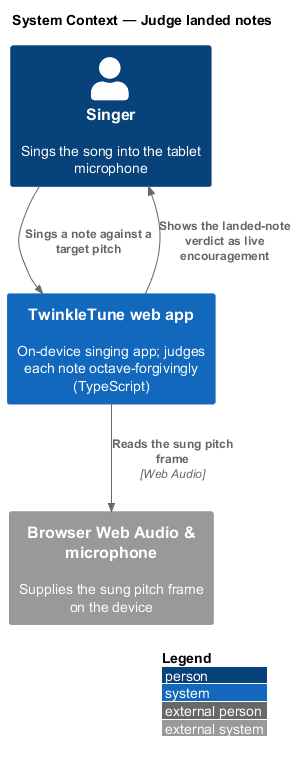
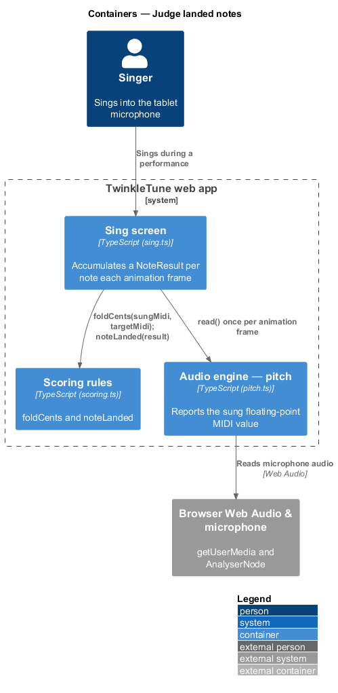
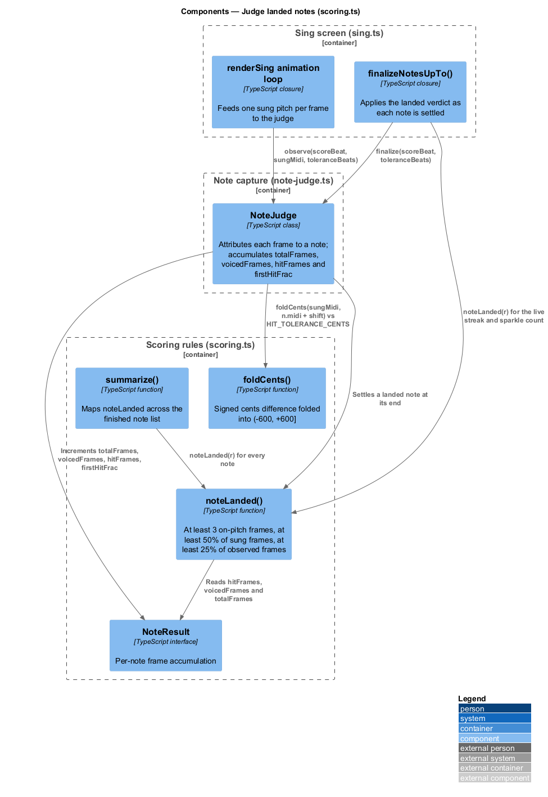
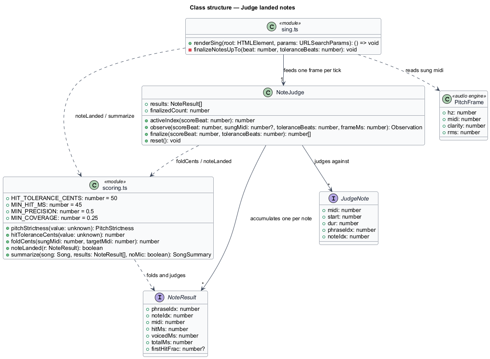
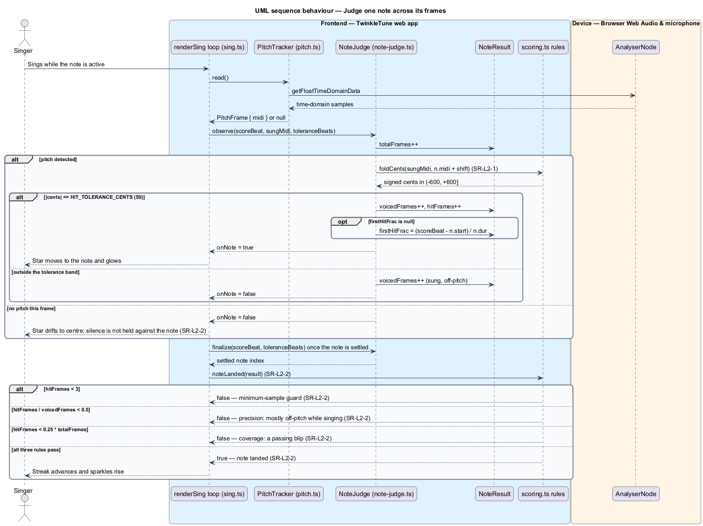

# Judge Landed Notes

## Overview

TwinkleTune decides whether a child sang a note, and it decides generously. Two
rules carry that judgement: pitch is compared by pitch class, so the right note
sung an octave away still counts, and a note is credited once the child was
on-pitch for half of the time she was heard singing it, for a meaningful share
of the note. Silence inside a note — a breath, a consonant, a
late start — is never held against her. Every star, sparkle, streak, and tricky
part downstream rests on these two rules, so they sit at the base of the scoring
subsystem and nothing else in it re-derives them.

scoring and results — subsystem that turns a captured performance into an
accuracy, a star rating, dimensioned feedback, and a results screen

This feature covers the two decisions only: the octave-folded comparison of one
sung pitch against one target pitch, and the landed/not-landed verdict for one
note. Producing the pitch itself belongs to the audio engine, attributing frames
to notes during play belongs to singing gameplay, and reducing landed notes into
a summary belongs to the summarize feature.

The terms below are used throughout.

- pitch class — note identity modulo an octave, so MIDI 48, 60, and 72 share one
  class
- octave folding — comparison of two pitches by pitch class, discarding the
  octave each was sung in
- folded cents difference — signed distance in cents between sung and target
  pitch after octave folding, held in (−600, +600]
- hit tolerance — ±50 cent band inside which one sung frame counts as on-pitch
- observed frame — animation frame that fell inside a note's span, whether or
  not a voice was heard in it
- sung frame — frame attributed to a note in which a pitch was detected
- on-pitch frame — sung frame inside the hit tolerance of its note
- frame time — time a frame stands for: the time since the previous frame,
  capped at 40 ms
- observed time, sung time, on-pitch time — sums of the frame times of a note's
  observed, sung, and on-pitch frames, in milliseconds
- note result — per-note accumulation of observed time, sung time, on-pitch
  time, and the position of the first on-pitch frame
- minimum-sample guard — floor of 45 ms of on-pitch time, below which a note
  cannot land however well it was sung
- precision — share of a note's sung time that was on-pitch; at least half is
  required
- coverage — on-pitch time as a share of the note's observed time; at least a
  quarter is required, so a passing blip does not land a long note
- landed note — note that passes the minimum-sample guard, the precision rule,
  and the coverage rule
- first-hit fraction — position within a note, from 0 to 1, at which the first
  on-pitch frame occurred, or `null` when the note was never hit
- reference singer — synthesised child-like voice (unvoiced consonants, scooped
  onsets, early releases, light vibrato, ±15 cent wander) used to verify the
  rules end to end

## Description

The rules live in `frontend/src/state/scoring.ts`; the frame attribution that
feeds them lives in `frontend/src/state/note-judge.ts`, driven by the sing
screen. No server participates.

Frontend — scoring rules (`frontend/src/state/scoring.ts`):

- **`foldCents(sungMidi, targetMidi)`** — function returning the signed cents
  difference between two MIDI values after octave folding. It takes
  `(sungMidi − targetMidi) % 12`, subtracts 12 when the remainder exceeds 6, adds
  12 when it is at or below −6, and multiplies by 100. The `d === 0 ? 0 : d * 100`
  form normalizes the negative zero JavaScript's `%` can produce. A fifth up
  (MIDI 67 against 60) therefore reads as −500 cents, a fourth down.
- **`HIT_TOLERANCE_CENTS`** — exported constant `50`, the half-width of the
  on-pitch band applied to the folded difference.
- **`noteLanded(r)`** — predicate returning true when all three hold:
  `r.hitMs >= MIN_HIT_MS` (minimum-sample guard),
  `r.hitMs >= MIN_PRECISION * r.voicedMs` (precision), and
  `r.hitMs >= MIN_COVERAGE * r.totalMs` (coverage). Time with no detected pitch
  appears only in `totalMs`, and there only through the quarter-coverage floor,
  so a note sung late, after a consonant, or released early is still judged on
  what was sung.
- **`NoteResult`** — interface carrying `phraseIdx`, `noteIdx`, `midi`, `hitMs`,
  `voicedMs`, `totalMs`, and `firstHitFrac`. One instance exists per note in the
  played window. The three tallies are milliseconds, so the verdict is the same
  at 30 frames a second as at 60.

Frontend — accumulation and consumption:

- **`NoteJudge` (`frontend/src/state/note-judge.ts`)** — builds one `NoteResult`
  per note and, once per frame, attributes the sung pitch to the active note or
  to a neighbouring note within the timing tolerance, adding the frame's time to
  `totalMs`, `voicedMs`, and `hitMs` accordingly. A frame is
  on-pitch when `Math.abs(foldCents(sungMidi, n.midi + shift)) <=
  HIT_TOLERANCE_CENTS`; the target is the transposed note, so judgement happens
  in the singer's own key. The attribution order is specified by the capture and
  score notes feature.
- **`finalizeNotesUpTo(beat)` (`frontend/src/screens/sing.ts`)** — calls
  `noteLanded(r)` for each note `NoteJudge.finalize` settles, and uses the
  verdict for the live streak counter and the running sparkle count, so the live
  display and the final summary agree on one rule.
- **`summarize(song, results, noMic)`** — maps `noteLanded` across every
  `NoteResult` into `landedFlags`, the single source every later assessment reads.

Test support — the reference singer (`frontend/src/testing/`):

- **`synthesizeSinging(song, singer, room)`** — renders a whole performance of a
  song to samples: one harmonic tone per note with the singer's lag, consonant
  gap, scoop, vibrato, pitch wander and early release, plus the room's noise.
- **`simulatePerformance(song, singer, room)`** — plays those samples through the
  shipped pipeline the way the sing loop does: one `PitchAnalyzer.analyze` window
  per 60 Hz frame, one `NoteJudge.observe` per frame, `noteLanded` per note.
- **`singing-acceptance.test.ts`** — asserts the `SR-L2-18` outcomes over every
  bundled song.

Constants (the shipped baseline): `HIT_TOLERANCE_CENTS = 50`,
`MIN_HIT_MS = 45`, `MIN_PRECISION = 0.5`, `MIN_COVERAGE = 0.25`, fold interval
`(−600, +600]`.

### Why the rule changed

The baseline rule divided on-pitch frames by every observed frame, so silence
counted as a wrong note. Driving the reference singer through the shipped
pipeline over all seven bundled songs (210 notes, 34 of them half a beat or
less) showed the cost, and what the revised rule with the timing tolerance of
singing gameplay recovers:

| Reference singer | Baseline rule | Revised rule |
|------------------|---------------|--------------|
| In tune, on the beat | 91% landed (short notes 50%) | 99% (short notes 94%) |
| In tune, 180 ms behind the beat | 46% (short notes 29%) | 94% (short notes 65%) |
| A semitone sharp | 1% | 2% |
| Silent, noisy room | 0% | 0% |

### Why time and not frames

The first revision counted frames: at least 3 on-pitch frames. Three frames are
50 ms on a display drawing 60 frames a second but 100 ms at 30, which is most of
a quarter-beat note, so a slower tablet stopped crediting short notes for no
musical reason. Measuring the same evidence in time removes the dependence:
45 ms is 3 frames at 60 frames a second and 2 frames at 30. The 40 ms cap on a
frame's time keeps a stalled frame from being credited with singing nobody
analysed, and means a single frame can never land a note by itself.

| Reference singer, in tune, on the beat | Counting frames | Counting time |
|----------------------------------------|-----------------|---------------|
| 60 frames a second | 99.5% landed (short notes 97%) | 99.5% (short notes 97%) |
| 30 frames a second | 97% (short notes 79%) | 99.5% (short notes 97%) |
| 20 frames a second | 93% (short notes 59%) | 95% (short notes 71%) |

## Requirements

The feature realizes the following level-2 (L2) requirements. Each L2 requirement
refines a level-1 (L1) requirement, cited by identifier.

| L2 ID | Refines (L1) | Requirement |
|-------|--------------|-------------|
| `SR-L2-1` | `SR-L1-1` | The system shall compare sung and target pitch by pitch class, returning the signed cents difference folded into (−600, +600], so an exact pitch class in any octave reads as 0 cents. |
| `SR-L2-2` | `SR-L1-2` | A note shall be counted as landed only if it has at least 45 ms of on-pitch time, at least half of its sung time is on-pitch — within ±50 cents, octave-folded — and its on-pitch time is at least a quarter of the time it was observed. Time with no detected pitch shall not count against the note. |
| `SR-L2-18` | `SR-L1-1, SR-L1-2` | Taken end to end, the system shall credit a child who sings in tune but imperfectly in time — at least 90% of notes for the reference singer on the beat or 180 ms behind it, including at least 60% of notes of half a beat or less — and shall not credit singing a semitone sharp (at most 5%) or a silent, noisy room (none). |

| `SR-L2-19` | `SR-L1-2` | The landed decision shall give the same credit at 60 and at 30 frames a second — at least 95% of notes and 90% of short notes for the reference singer at 30 — and degrade gently below that, with at least 90% of notes at 20 frames a second and no more than 5% for a singer a semitone sharp. |

## Diagrams

### System context

The singer sings into the TwinkleTune web app, which judges each note on the
device against the song's target pitches; no audio and no verdict leaves the
tablet (`SR-L2-1`, `SR-L2-2`).

### Containers

The sing screen polls the audio engine for a pitch frame each animation frame and
asks the scoring module whether that frame is on-pitch and whether the finished
note landed (`SR-L2-1`, `SR-L2-2`).

### Components

`foldCents` and `noteLanded` are the two rules; `NoteJudge` accumulates a
`NoteResult` per note for the sing loop and reads `foldCents`, and
`finalizeNotesUpTo` and `summarize` read `noteLanded` over the settled notes.

### Class structure

`NoteResult` is the record the two rules operate on; `HIT_TOLERANCE_CENTS` is the
band `foldCents` output is tested against, and the three `MIN_*` constants are
the landed thresholds (`SR-L2-1`, `SR-L2-2`).

### Behaviour — judge one note across its frames

Each frame folds the sung pitch against the transposed target and counts its
time as a hit inside ±50 cents (`SR-L2-1`); a frame with no pitch adds only
observed time.
When the note is settled, the minimum-sample guard, the precision rule, and the
coverage rule decide whether it landed (`SR-L2-2`). The `alt` branches model the
three rejections.

