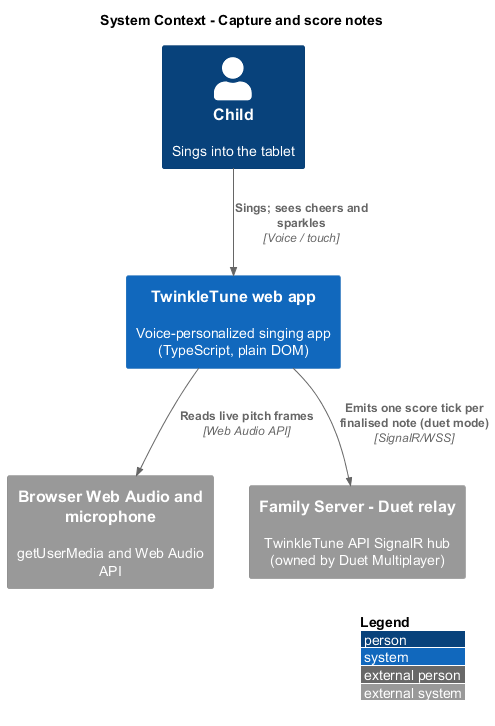
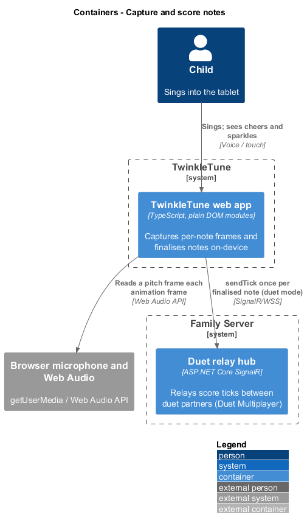
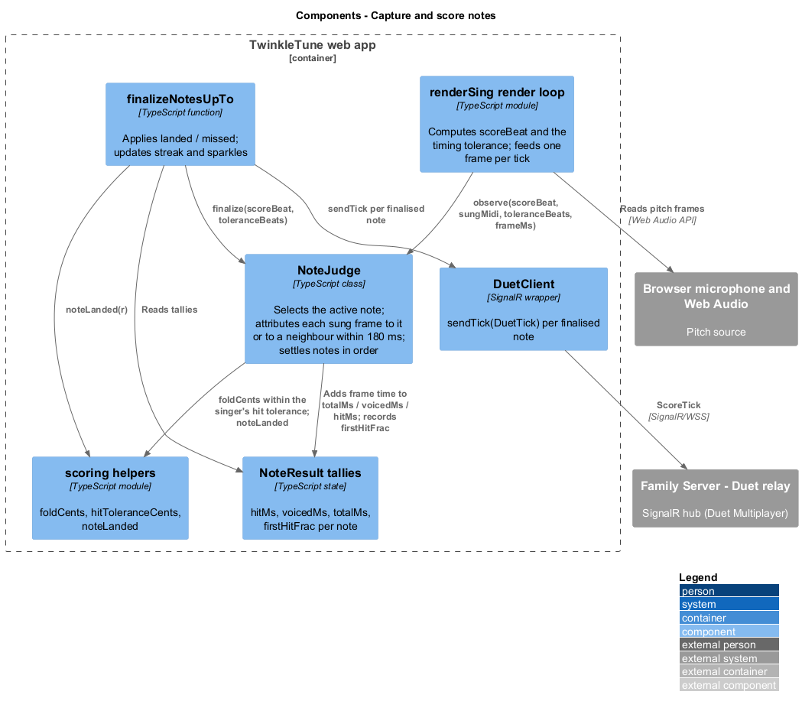
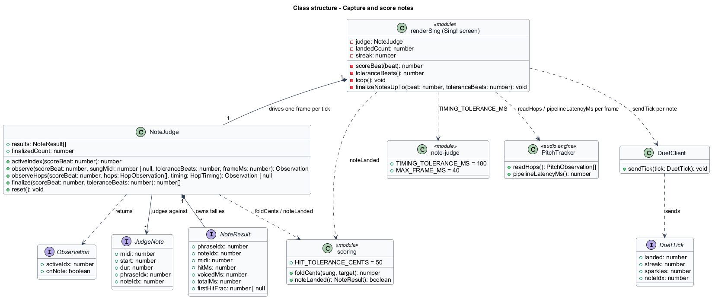
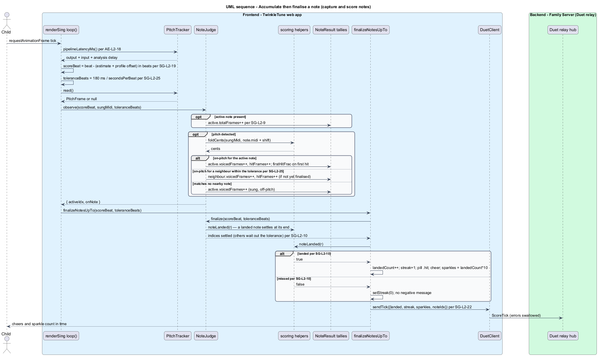

# Capture and score notes

## Overview

While a child sings, the Sing! screen watches each note and records how it went —
frame by frame — so the results screen can turn the performance into stars and
sparkles. This feature covers that live capture: choosing the note being sung,
attributing each sung frame to the note it belongs to even when the child is a
little behind or ahead of the beat, settling each note's outcome as it passes,
compensating for microphone latency, and, in duet mode, reporting one score tick
per note.

*per-note capture* — running tally, held per note, of time observed, time sung,
time on-pitch, and where in the note the first on-pitch frame fell

*frame time* — time a frame stands for: the time elapsed since the previous
frame, capped at 40 ms, about the audio one analysis window covers

*active note* — in-window note whose beat span currently contains the
latency-compensated score beat

*score beat* — latency-compensated beat position used only for scoring, computed
as the raw beat minus the pipeline latency estimate and the mic timing offset,
expressed in beats

*pipeline latency estimate* — the audio engine's figure for how long after the
playback clock reaches a beat the singing for that beat is detected: reported
output delay, reported input delay, and half the analysis window

*sung frame* — frame in which the audio engine detected a pitch

*on-pitch frame* — sung frame whose pitch is within the singer's hit tolerance of
a note after octave folding and the song shift are applied

*hit tolerance* — 80, 65, or 50 cents, by the pitch strictness level a grown-up
chose for the singer; 50 when she has none

*timing tolerance* — 180 ms of real time either side of a note's span inside
which a sung frame that matches the note is still credited to it

*neighbouring note* — note other than the active one whose span ended, or will
begin, within the timing tolerance of the score beat

*finalisation* — settling of a note's outcome, landed or missed, once its end
beat has passed and, for a note not yet landed, the timing tolerance after it

*landed note* — note with at least 45 ms of on-pitch time that makes up at
least half of its sung time and a quarter of its observed time, per the Scoring
criterion

*duet score tick* — one-per-note message to the duet relay carrying the landed
count, streak, sparkles, and note index

Accurate, forgiving scoring depends on faithful per-note capture during play.
Budget tablets add audible input lag and wireless speakers add output lag, so
scoring reads a latency-compensated beat while the visuals scroll on the raw
beat, keeping cheers in time. Young singers
follow a melody rather than lead it, so the tail of one sung note routinely
spills into the next note's span; the timing tolerance credits that tail to the
note it belongs to instead of marking it as a wrong pitch on the next. The
capture and finalisation run on-device; the only outbound touch is the optional
duet score tick, whose relay is owned by Duet Multiplayer.

## Description

Capture lives in `NoteJudge` (`frontend/src/state/note-judge.ts`), a pure class
with no DOM or audio dependency. The `loop()` and `finalizeNotesUpTo()` functions
of `frontend/src/screens/sing.ts` feed it one frame per animation tick and turn
the notes it settles into cheers, streaks, and duet ticks.

- **`NoteJudge(notes, shift, toleranceCents)`** — built from the `windowNotes` of
  the session, the song shift, and the active singer's hit tolerance,
  `hitToleranceCents(profile.strictness)`. The tolerance defaults to
  `HIT_TOLERANCE_CENTS` and is fixed for the life of the judge, so a level changed
  in the Grown-Ups Corner applies from the next song. It owns **`results`**, one `NoteResult` per note holding
  `hitMs`, `voicedMs`, `totalMs`, and `firstHitFrac` (from
  `frontend/src/state/scoring.ts`), and a cursor of settled notes.
- **`latencyBeats` / `scoreBeat`** — `latencyMs = profile.latencyMs +
  tracker.pipelineLatencyMs()`; `latencyBeats = (latencyMs / 1000) /
  player.secondsPerBeat()`; `scoreBeat = beat - latencyBeats`. The estimate comes
  from the audio engine each frame and needs no calibration; the profile offset
  is a grown-up's correction on top. Visuals use `beat`; scoring uses
  `scoreBeat`. In no-mic mode nothing is scored and only the profile offset is
  applied.
- **`toleranceBeats`** — `TIMING_TOLERANCE_MS / 1000 / player.secondsPerBeat()`,
  recomputed each frame so slow practice gets the same 180 ms of real time. It is
  0 in no-mic mode, where nothing is captured.
- **`NoteJudge.activeIndex(scoreBeat)`** — the first unsettled note with
  `scoreBeat >= n.start && scoreBeat < n.start + n.dur`. It selects the active
  note, whose pill the loop marks `now`.
- **`tracker.readHops()`** — once per animation frame the loop takes every
  observation the audio engine has for it: one per 1/60 s hop of audio since the
  previous frame, oldest first, each a pitch frame or none with the age of its
  window. A slow or stuttering frame therefore brings several observations and a
  120 Hz display brings one on every other frame.
- **`NoteJudge.observeHops(scoreBeat, hops, { toleranceBeats, secondsPerBeat,
  hopMs })`** — judges the observations in order, each through `observe` at its
  own score beat, `scoreBeat - hop.ageMs / 1000 / secondsPerBeat`, and each
  standing for `hopMs` of time. It returns the `Observation` of the newest hop,
  or `null` when there were none, in which case the loop keeps the star's
  on-note state as it was.
- **`frameMs`** — time one observation stands for. `observe` caps it at
  `MAX_FRAME_MS`; `observeHops` passes the hop, 16.7 ms.
- **`NoteJudge.observe(scoreBeat, sungMidi, toleranceBeats, frameMs)`** — tallies
  one frame of `t = min(frameMs, MAX_FRAME_MS)` milliseconds. It adds `t` to the
  active note's `totalMs`, then, when a pitch was detected, attributes the frame
  in this order:
  1. the active note, when the frame is on-pitch for it — `t` is added to
     `voicedMs` and `hitMs`, and `firstHitFrac` is set on the first hit;
  2. otherwise the nearest neighbouring note for which the frame is on-pitch —
     credited the same way if that note is not yet settled, with `firstHitFrac`
     clamped to 0 (sung early) or 1 (sung late); either way the frame is not
     counted against the active note;
  3. otherwise the active note, as a sung but off-pitch frame — `t` is added to
     `voicedMs` only.

  It returns `{ activeIdx, onNote }`; `onNote` is true whenever the frame matched
  a note. The newest observation's `onNote` drives the star's on-note glow and
  the scene burst.
- **on-pitch test** — `abs(foldCents(sungMidi, n.midi + shift)) <=
  toleranceCents`. **`foldCents(sung, target)`** is the octave-folded cents
  difference in `(-600, 600]`, so any octave counts. The same test, with the same
  tolerance, serves the active note and a neighbouring note. Where two notes'
  bands overlap — a semitone apart, they overlap on Gentle and Just right — the
  attribution order above decides, and the active note takes the frame.
- **`NoteJudge.finalize(scoreBeat, toleranceBeats)`** — settles notes in song
  order and returns their indices. The earliest unsettled note is settled once
  its end has passed and either it is already landed or the timing tolerance
  after its end has also passed. Late credit can only raise a note's counts, so a
  note that is landed at its end stays landed and is cheered without delay.
- **`finalizeNotesUpTo(beat, toleranceBeats)`** — for each settled note applies
  **`noteLanded(r)`**, the Scoring criterion. On a landed note, `landedCount++`,
  `setStreak(streak + 1)`, the pill gains `hit`, `cheerPop()` fires, and the
  sparkle pill is set to `landedCount * 10`. On a missed note, `setStreak(0)`; no
  negative message shows.
- **`NoteJudge.reset()`** — clears every tally and the cursor for "Start over".
- **`duet?.client.sendTick(...)`** — after each finalised note, one `DuetTick`
  (`{ landed, streak, sparkles, noteIdx }`) is sent through the `DuetClient`
  (`frontend/src/api/duet.ts`). `sendTick` swallows delivery errors so play
  continues.

Constants (the shipped baseline): `TIMING_TOLERANCE_MS = 180`,
`MAX_FRAME_MS = 40`; hit tolerance `80` / `65` / `50` cents by level
(`HIT_TOLERANCE_CENTS = 50`).

## Requirements

The feature realizes the following level-2 (L2) requirements, each refining the
cited level-1 (L1) requirement(s).

| L2 ID | Refines (L1) | Requirement |
|-------|--------------|-------------|
| `SG-L2-9` | `SG-L1-4` | Each frame shall stand for the time since the previous frame, capped at 40 ms. For the currently active note (outside no-mic mode), each frame shall add its time to the observed time. A sung frame shall be attributed per `SG-L2-25`; one within the singer's hit tolerance (`SR-L2-20`) of its note (octave-folded, shift applied) shall add its time to that note's sung and on-pitch time and, on the first such frame, record the fractional position within the note. A sung, off-pitch frame shall add only to the active note's sung time; a frame with no pitch shall change nothing else. |
| `SG-L2-10` | `SG-L1-4, SG-L1-5` | Notes shall be finalised in song order: as a note's end passes if it is already landed, otherwise once the timing tolerance after its end has also passed. A landed note shall increment the landed count and streak, mark the pill, show a random cheer, and update the live sparkle count to `landedCount·10`; a missed note shall reset the streak to 0. No missed note shall produce a negative message. |
| `SG-L2-19` | `SG-L1-8` | Scoring shall use a latency-compensated beat position — the raw beat minus the sum of the engine's pipeline latency estimate (`AE-L2-18`) and the profile's mic timing offset — while visuals use the raw beat, so that a device with output or input lag still scores the note the child is actually singing. |
| `SG-L2-22` | `SG-L1-4` | In duet mode, the system shall emit a score tick once per finalised note (not per frame), carrying the landed count, streak, sparkles, and note index; tick delivery failures shall be swallowed so play is never interrupted. (Relay semantics: DM.) |
| `SG-L2-26` | `SG-L1-4, SG-L1-8` | Each animation frame the system shall take every observation the audio engine returns (`AE-L2-21`) and judge them oldest first, each at its own score beat — the frame's score beat minus the observation's age — and each standing for one hop of time; a frame with no observation shall judge nothing and leave the on-note state as it was. |
| `SG-L2-25` | `SG-L1-4, SG-L1-8` | Each sung frame shall be attributed to at most one note, where on-pitch means within the singer's hit tolerance (`SR-L2-20`) for the active note and a neighbour alike: the active note when on-pitch for it; otherwise the nearest note whose span ended, or begins, within 180 ms of the score beat and for which it is on-pitch (credited if not yet finalised, and never counted against the active note); otherwise the active note as a sung, off-pitch frame. The tolerance is real time. Where two notes' bands overlap, the active note takes the frame. |

## Diagrams

### System context

The child sings into the tablet; the TwinkleTune web app scores on-device and, in
duet mode only, sends one score tick per note to the Family Server's duet relay.

### Containers

Capture and scoring run inside the web app container. The optional duet score tick
travels to the Family Server over SignalR; all other work is local.

### Components

The render loop hands each frame to `NoteJudge`, which attributes it and
accumulates `NoteResult`; `finalizeNotesUpTo` applies `noteLanded` to the notes
the judge settles, and `DuetClient.sendTick` reports each one.

### Class structure

`NoteJudge` owns the `NoteResult` tallies and applies `foldCents` and
`noteLanded` from Scoring; the render loop drives it and emits a `DuetTick`
through `DuetClient`.

### Behaviour — accumulate then finalise a note

Each frame is attributed at the latency-compensated score beat: to the active
note, to a neighbouring note within the timing tolerance, or to the active note
as off-pitch. A landed note is finalised as its end passes and a not-yet-landed
note after the tolerance; a landed note raises the counts and every finalised
note emits one duet tick. The alternate branch shows a missed note resetting the
streak with no negative message.

