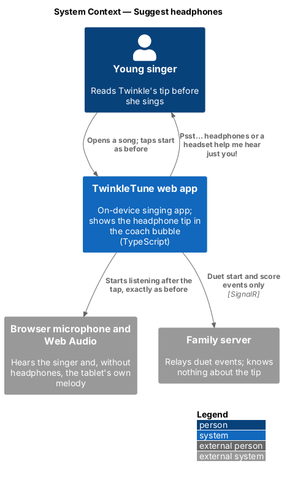
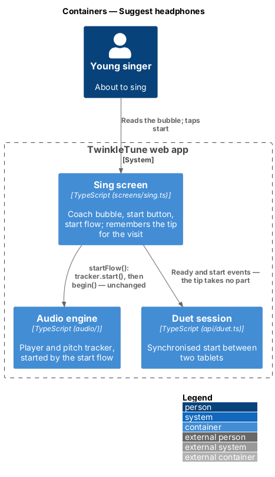
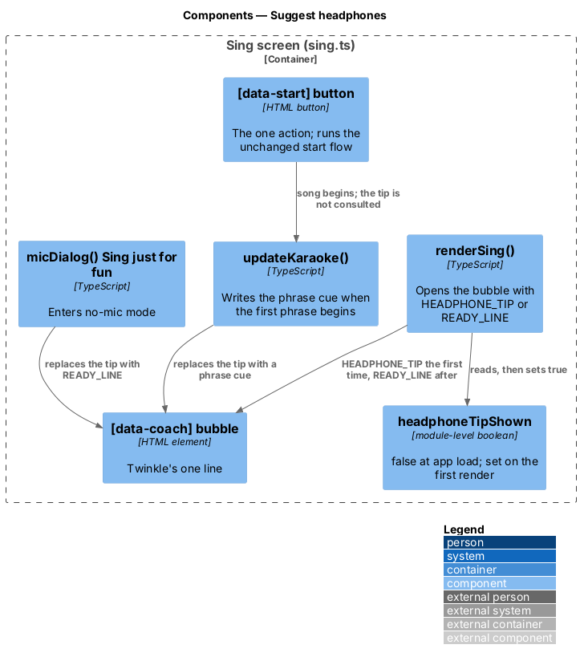
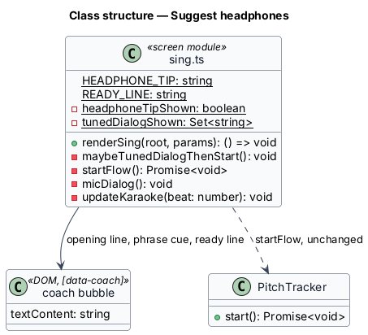
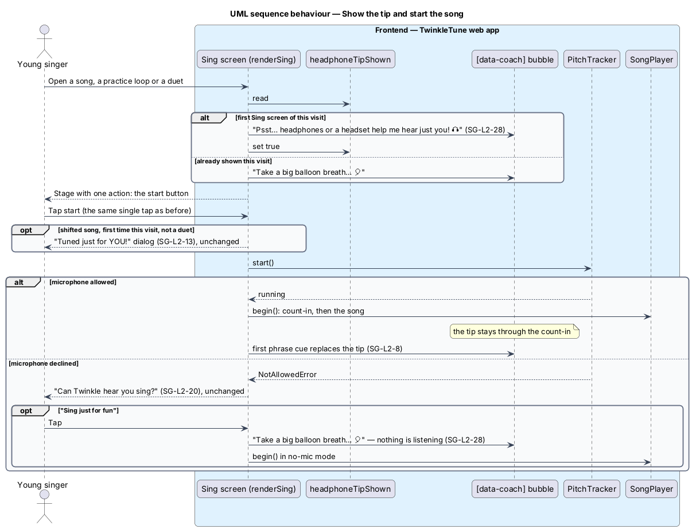

# Suggest Headphones

## Overview

A tablet's microphone hears the melody the tablet plays as well as the child.
Headphones or a headset take the melody out of the room, so the app hears just
her and its cheers land on the notes she really sang. The app cannot tell
whether headphones are in use, and it must never make her feel she is doing
something wrong without them. So it says it once, lightly, in Twinkle's own
voice, at the moment she is about to sing, and then gets out of the way.

The tip is a line in the coach bubble on the Sing screen before the start. It is
not a dialog and not a step: the start button stays the one action on the
screen, and a song, a practice loop and a duet all start with the same taps as
before.

The terms below are used throughout.

- headphone tip — the one-line suggestion that headphones or a headset help
  Twinkle hear just the singer
- coach bubble — Twinkle's speech bubble beside the mascot on the Sing screen,
  `[data-coach]`
- ready line — the coach bubble's usual line before the start, "Take a big
  balloon breath… 🎈"
- visit — one load of the app, from opening it to closing or reloading it
- phrase cue — the coach line that replaces the bubble's text when a phrase
  begins

The feature covers the tip's words, where and how often it appears, and what
removes it. Choosing which microphone listens is a separate feature in the
grown-ups corner.

## Description

The feature is a frontend-only slice inside `frontend/src/screens/sing.ts`. It
adds no module, no storage and no network call.

- **`HEADPHONE_TIP`** — the constant `'Psst… headphones or a headset help me
  hear just you! 🎧'`.
- **`READY_LINE`** — the constant `'Take a big balloon breath… 🎈'`, the line
  the bubble has always opened with.
- **`headphoneTipShown`** — a module-level boolean beside `tunedDialogShown`,
  `false` when the app loads. It is the whole of the feature's memory: nothing
  is written to `localStorage`, so a reload or a new visit shows the tip again.
- **render** — `renderSing` reads `headphoneTipShown` once it has passed its
  entry guards (the song exists; a duet has its session), puts `HEADPHONE_TIP`
  in `[data-coach]` when it is `false` and `READY_LINE` otherwise, and sets the
  flag. A bounced render (unknown song) does not use up the tip.
- **start flow, unchanged** — `[data-start]` still calls
  `maybeTunedDialogThenStart()`, which shows "Tuned just for YOU!" once per song
  per visit and then calls `startFlow()`, which starts the tracker and calls
  `begin()`. The tip is not consulted anywhere in that chain.
- **replacement by the phrase cue** — `updateKaraoke(beat)` sets
  `coachEl.textContent` to a phrase cue when the first phrase comes within one
  beat. The tip therefore stays through the count-in and goes when the singing
  starts. No timer is involved.
- **no-mic mode** — the "Sing just for fun" handler in `micDialog()` sets
  `coachEl.textContent = READY_LINE` before `begin()`. Nothing is listening in
  that mode, so advice about being heard would be beside the point.
- **duet** — the duet path renders the same bubble under the same rule. The
  synchronised start is driven by `duet.client` events from the lobby and by the
  "I'm ready!" tap; the tip is local text and is not part of either. One tablet
  may show the tip while the other shows the ready line, and both start
  together.
- **practice** — a practice loop is the Sing screen with `practice` in its
  query. It follows the same rule; in practice it follows a song, so the tip has
  normally been shown already.

The encouragement test, applied to the copy:

| Check | "Psst… headphones or a headset help me hear just you! 🎧" |
|-------|--------------|
| Does it say she did something wrong? | No. It is about what helps Twinkle, not about her. |
| Does it make singing without headphones a mistake? | No. There is no "should", "need" or "must", and nothing changes if she ignores it. |
| Does it read as a warning or an error? | No. "Psst…" is a friend's aside; the 🎧 is decoration, and no colour or icon marks a status. |
| Is it short enough for a nine-year-old before a song? | Eleven words, in the bubble she already reads. |
| Is it in Twinkle's first-person voice (`CE-L2-2`)? | Yes: "help me hear just you". |

## Requirements

The feature realizes the following level-2 (L2) requirement. The L2 requirement
refines a level-1 (L1) requirement, cited by identifier.

| L2 ID | Refines (L1) | Requirement |
|-------|--------------|-------------|
| `SG-L2-28` | `SG-L1-10` | Before a song starts, the Sing screen shall show a headphone tip in Twinkle's coach bubble, the first time the screen opens in a visit; it shall add no tap, dialog or wait, play no part in a duet's synchronised start, give way to the usual line in no-mic mode, and stay within the encouragement-only guarantee (`CE-L2-8`). |

## Diagrams

### System context

The singer reads the tip on her own tablet; nothing about it leaves the device
or is stored on it (`SG-L2-28`).

### Containers

The Sing screen is the only container involved; the audio engine and the duet
session it also uses are untouched by the tip (`SG-L2-28`).

### Components

The render picks the bubble's opening line from one flag; the phrase cue and the
no-mic handler are the two things that replace it (`SG-L2-28`).

### Class structure

The feature is two constants and one flag in the Sing screen module, read by
`renderSing` and written to the coach bubble (`SG-L2-28`).

### Behaviour — show the tip and start the song

The tip is on screen when the screen appears. The tap on the start button runs
the same chain as before, and the first phrase cue replaces the tip
(`SG-L2-28`).

## Open questions

Decisions taken, with their known consequences.

1. **A line in the coach bubble, not a dialog.** A dialog would add a tap before
   every first song and would have to be acknowledged in a duet on both tablets
   before the synchronised start. The bubble adds nothing to the flow.
   Consequence: a child who taps start at once sees the tip only through the
   count-in, about three beats.
2. **Once per visit, remembered in memory only.** The first Sing screen of a
   visit shows it; later ones show the ready line. This follows the "Tuned just
   for YOU!" dialog, which is also remembered per visit. Consequence: an
   installed app left open for days shows the tip once in that time, and a
   reload shows it again. A per-day rule would need a stored date; deferred
   until there is evidence the tip is missed.
3. **The tip replaces the balloon-breath line that first time.** The bubble
   holds one line. The breath reminder returns from the second song on.
4. **Shown even when a headset is in use.** The app does not detect headphones
   (deferred). The tip is phrased so that it is true and friendly either way.
5. **Shown before the app knows whether the microphone will be allowed.** If she
   goes on in no-mic mode the bubble returns to the ready line; until then the
   tip may show to a child who will not be listened to. It asks nothing of her.
6. **Not on Find My Voice or the tuner, and not in the tips library.** Deferred.
7. **The grown-up's version lives in the hub.** The microphone picker's hint
   says a headset works best and why (`GC-L2-12`). The child's line gives no
   reason beyond "help me hear just you".
